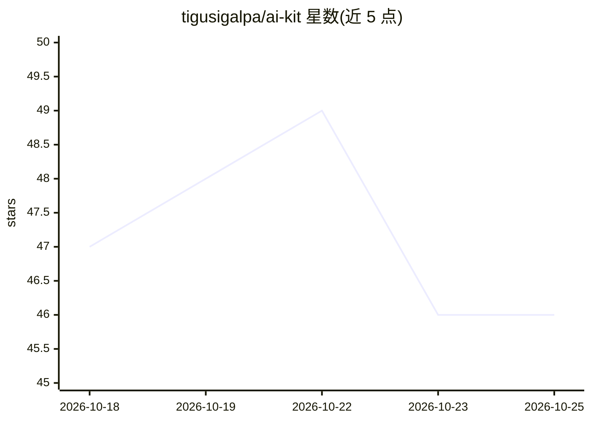

# tigusigalpa/ai-kit

⭐ 46 · Python · MIT · 推送 2026-10-20 · [GitHub](https://github.com/tigusigalpa/ai-kit) · 个人维护

**给编码 AI 客户端的开发启动套件：项目记忆、栈规则与模型路由**

面向使用 Codex、Claude Code、Cursor、Copilot 等 11 种编码代理的开发者的工具包：为每个项目安装持久化上下文（PROJECT_CONTEXT/project.json）、按技术栈（Go/PHP/Laravel/Python/Rust/.NET 等）自动加载专家规则、为 11 种客户端写入原生配置文件；提供 0-6 级自适应模型路由（可映射 OpenAI/Anthropic/Kimi/Gemini 或本地 Ollama 模型）、Kubernetes 就绪的 Docker 模板、提交确认与秘钥排除等护栏，以及三个一键工作流命令。安装支持 Docker 镜像与 pip 包，离线安装器先预览再应用变更，无强制第三方运行时依赖。

## 筛选速览

| 维度 | 判定 | 备注 |
|---|---|---|
| AI 角色 | `ai-ecosystem` | LLM/agent 周边工具 |
| 许可风险 | `permissive` | MIT |
| 部署形态 | `desktop` | 安装包/桌面程序 |
| 模型依赖 | local-ok | 支持本地模型 |
| 硬件要求 | — | 无带数字的原话,不猜 |
| 安装摩擦 | `low` | 无编译、无系统依赖或容器化 |
| 成熟度 | — | 结构信号不足 |

## 能力要点

- 为 11 种 AI 客户端写入原生配置（AGENTS.md/CLAUDE.md/.cursor/rules 等）
- 按模块自动检测技术栈并加载对应专家规则，monorepo 可组合多 profile
- 0-6 级自适应模型路由，离线 router.py 解释选择并可配置本地/Ollama 模型
- 离线安装器：预览变更、备份、保留本地编辑，无强制依赖

## 适用场景

- 让每次新开的 AI 编码会话自动读取项目记忆与栈规则，避免重复解释项目
- 为多种 AI 客户端统一生成配置与秘钥排除规则
- 按任务难度路由模型，控制不同能力层级的开销
- 为项目生成 Kubernetes 就绪的容器与部署模板

## 场景标签

`模型网关` `提示工程` · 领域:Agent 开发

## 证据(README 行号)

> L7: AI-KIT gives your coding agents persistent project memory, expert stack rules, **Kubernetes-ready** containers, **ad
> L44: |🤖|**11 AI clients**|Codex, Claude Code, Cursor, Copilot, Gemini CLI, Windsurf, Cline, Roo, Aider, Kimi, Manus — wi
> L123: Provider configurations map roles to OpenAI, Anthropic, Kimi, and Gemini models, or your own local/Ollama models. 

## 星数曲线

2026-10-18 47 → 2026-10-25 46（-1）

---
*卡片 v1 · prompt 1.4 · 生成 2026-10-25 · 置信度 mid · 依据 README sha `98f3fcbbce5d` · [字段定义](../../DATASET.md)*
