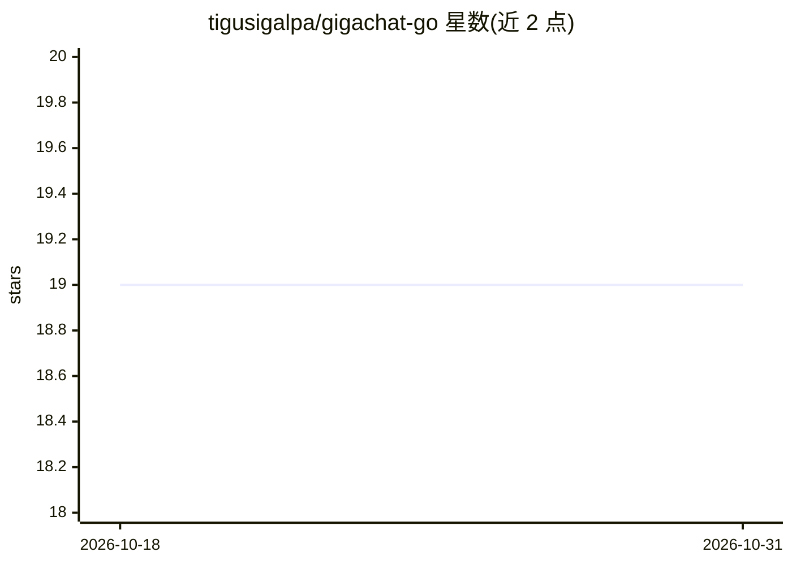

# tigusigalpa/gigachat-go

⭐ 19 · Go · MIT · 推送 2026-03-21 · [GitHub](https://github.com/tigusigalpa/gigachat-go) · 个人维护

**面向 Go 开发者的 Sber GigaChat API SDK，含流式与图像生成**

为 Sber GigaChat API 提供 Go 语言 SDK 库，覆盖聊天、流式响应、图像生成与下载（base64）、带上下文的对话管理，支持 GigaChat-2 / 2-Pro / 2-Max 与 embeddings 模型常量。内置 OAuth 2.0 TokenManager：线程安全令牌缓存与过期自动刷新；提供类型化错误、函数式配置选项与单元测试。使用需在 Sber AI 控制台注册获取 Client ID/Secret 生成 Authorization Key；图像生成依赖提示词中含特定指令词触发 text2image。

## 筛选速览

| 维度 | 判定 | 备注 |
|---|---|---|
| AI 角色 | `ai-ecosystem` | LLM/agent 周边工具 |
| 许可风险 | `permissive` | MIT |
| 部署形态 | `None` |  |
| 模型依赖 | — | README 未给出锁定关系 |
| 硬件要求 | — | 无带数字的原话,不猜 |
| 安装摩擦 | `low` | 无编译、无系统依赖或容器化 |
| 成熟度 | — | 结构信号不足 |

## 能力要点

- 自动 OAuth 令牌管理（线程安全缓存、过期自动刷新）
- 流式响应与图像生成/下载（base64）
- 支持 GigaChat-2 / 2-Pro / 2-Max 及 embeddings 模型
- 类型化错误与函数式配置选项，附单元测试与 mock HTTP 测试

## 适用场景

- 在 Go 应用中接入 GigaChat 构建聊天机器人
- 通过 SDK 生成文本或按描述生成图像
- 利用 embeddings 模型实现语义搜索

## 场景标签

 · 领域:LLM 基础设施/API SDK

## 证据(README 行号)

> L9: Golang SDK для Sber GigaChat API. Поддерживает streaming, генерацию изображений и работу с диалогами.
> L17: Библиотека для интеграции GigaChat в Go-приложения. Подходит для чат-ботов, генерации контента и изображений.
> L48: - Интеграция с GigaChat API

## 星数曲线

2026-10-18 19 → 2026-10-31 19（+0）

---
*卡片 v1 · prompt 1.4 · 生成 2026-10-28 · 置信度 high · 依据 README sha `e1050d5f3154` · [字段定义](../../DATASET.md)*
