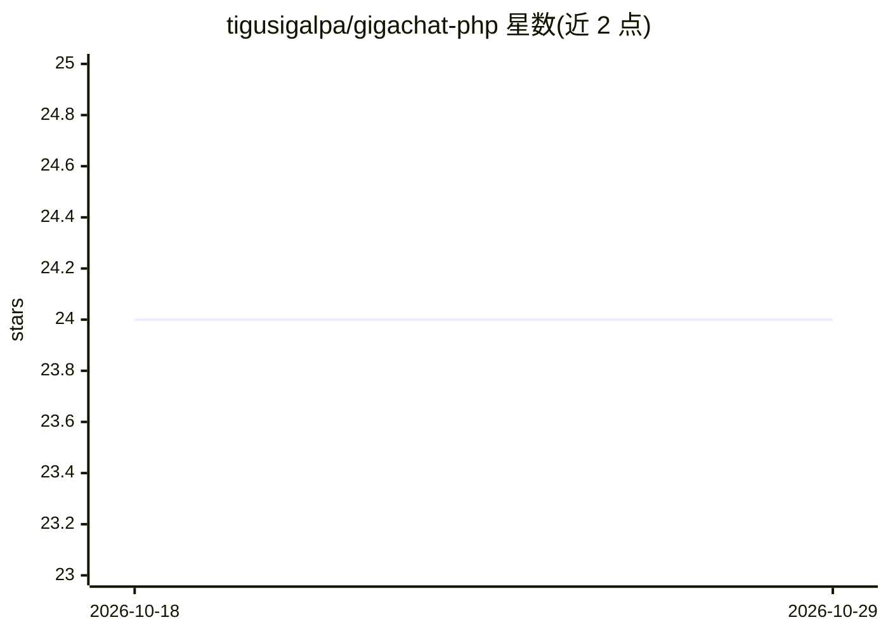

# tigusigalpa/gigachat-php

⭐ 24 · PHP · 推送 2026-04-13 · [GitHub](https://github.com/tigusigalpa/gigachat-php) · 个人维护

**PHP/Laravel 接入 Sber GigaChat API 的官方风格 SDK**

面向 PHP 与 Laravel 开发者的 Sber GigaChat API 客户端库：封装 OAuth 令牌获取与自动刷新，支持文本生成（chat、流式响应、多轮对话）、text2image 图像生成与下载、嵌入模型、系统提示词风格化。Laravel 侧提供 Service Provider、Facade、HasGigaChat Eloquent Trait、Artisan 命令、限流中间件。文档覆盖错误码分类与重试处理。要求 PHP 8.2+、Guzzle 7.8.2+ 及 GigaChat API 凭据，MIT 许可。提供俄/英双语文档，另有 Golang 版 SDK。

## 筛选速览

| 维度 | 判定 | 备注 |
|---|---|---|
| AI 角色 | `ai-ecosystem` | LLM/agent 周边工具 |
| 许可风险 | `none` | — |
| 部署形态 | `None` |  |
| 模型依赖 | — | README 未给出锁定关系 |
| 硬件要求 | — | 无带数字的原话,不猜 |
| 安装摩擦 | `low` | 无编译、无系统依赖或容器化 |
| 成熟度 | — | 结构信号不足 |

## 能力要点

- OAuth 令牌自动刷新管理
- 文本生成、流式响应、多轮对话与 text2image 图像生成/下载
- Laravel 8-13 集成：Facade、Service Provider、Artisan 命令、限流中间件、HasGigaChat Trait
- 错误码分类文档（401/402/413/422/429/500）与重试处理示例

## 适用场景

- 在 Laravel 应用中接入 Sber GigaChat 实现聊天机器人
- 通过 PHP 调用 GigaChat 的文本与图像生成能力
- 使用嵌入模型做语义搜索或内容生成工作流

## 场景标签

 · 领域:LLM API 客户端/PHP 开发

## 证据(README 行号)

> L5: PHP SDK для Sber GigaChat API с поддержкой Laravel. Streaming и обычные запросы.
> L17: - Интеграция с GigaChat API

## 星数曲线

2026-10-18 24 → 2026-10-29 24（+0）

---
*卡片 v1 · prompt 1.4 · 生成 2026-10-27 · 置信度 high · 依据 README sha `cc61c03fed7b` · [字段定义](../../DATASET.md)*
