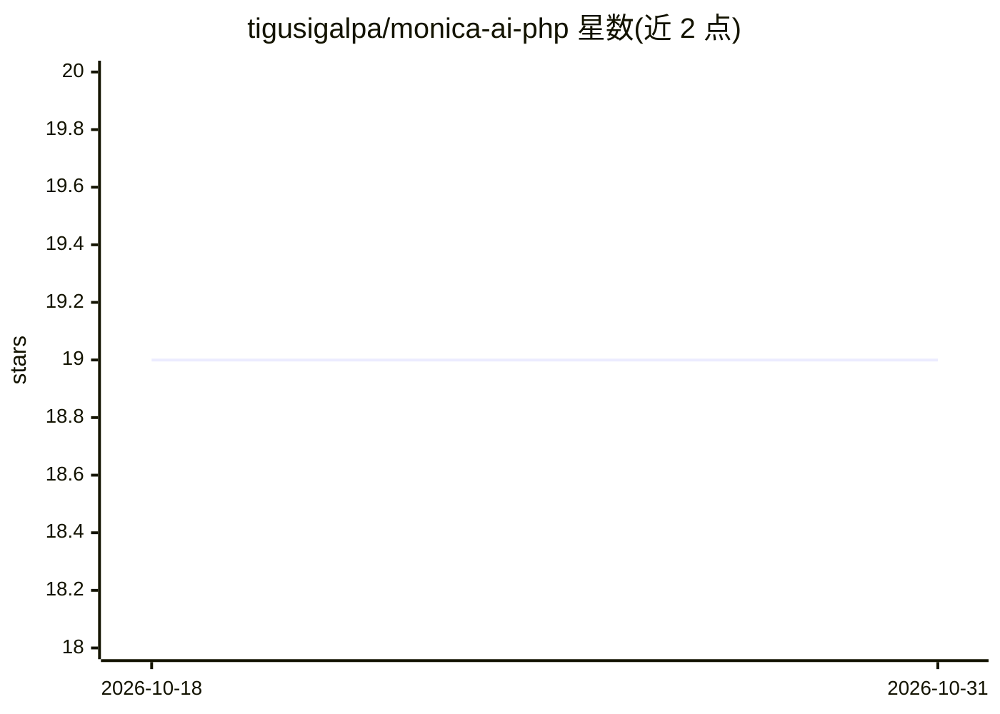

# tigusigalpa/monica-ai-php

⭐ 19 · PHP · MIT · 推送 2025-11-21 · [GitHub](https://github.com/tigusigalpa/monica-ai-php) · 个人维护

**面向 PHP 开发者的 Monica AI 平台统一 API 客户端 SDK**

Monica AI API 平台的 PHP 客户端库：通过统一接口访问 OpenAI、Anthropic、Google、DeepSeek、Meta、Grok、NVIDIA、Mistral 等多家模型，支持聊天补全（含多轮消息、图像输入/视觉模型）与图像生成（FLUX、Stable Diffusion、DALL·E、Playground、Ideogram）。使用 PHP 8.1+ 严格类型声明，依赖 Guzzle HTTP 7.0+，需自备 Monica AI API key；提供 Laravel 服务提供者集成示例、异常处理与模型管理方法，经 Composer 安装。

## 筛选速览

| 维度 | 判定 | 备注 |
|---|---|---|
| AI 角色 | `ai-ecosystem` | LLM/agent 周边工具 |
| 许可风险 | `permissive` | MIT |
| 部署形态 | `None` |  |
| 模型依赖 | — | README 未给出锁定关系 |
| 硬件要求 | — | 无带数字的原话,不猜 |
| 安装摩擦 | `low` | 无编译、无系统依赖或容器化 |
| 成熟度 | — | 结构信号不足 |

## 能力要点

- 单一接口访问 8 家 AI 提供商的聊天模型
- 支持视觉模型图像输入（文件/URL/Base64）与多模态消息
- 图像生成覆盖 FLUX/Stable Diffusion/DALL·E/Playground/Ideogram
- 提供 Laravel Service Provider 集成与 PSR-4 自动加载

## 适用场景

- 在 PHP/Laravel 应用中接入多家 AI 模型而无需逐家对接 SDK
- 构建带图像理解的聊天功能或文本生成图像功能
- 通过统一配置切换 GPT-5、Claude 4、Gemini 2.5 等模型

## 场景标签

`图像生成` `模型网关` · 领域:Agent 开发

## 证据(README 行号)

> L9: A powerful and elegant PHP client (SDK) library for Monica API Platform - your unified
> L15: - **Unified API Access**: Single interface to multiple AI providers (OpenAI, Anthropic, Google, DeepSeek, Meta, Gro
> L85: composer require tigusigalpa/monica-ai-php

## 星数曲线

2026-10-18 19 → 2026-10-31 19（+0）

---
*卡片 v1 · prompt 1.4 · 生成 2026-10-28 · 置信度 high · 依据 README sha `14f56e4ec169` · [字段定义](../../DATASET.md)*
