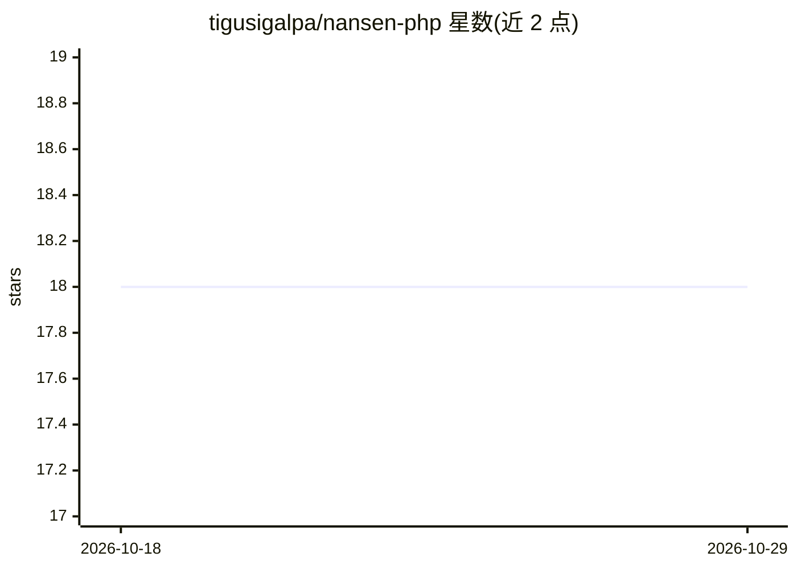

# tigusigalpa/nansen-php

⭐ 18 · PHP · MIT · 推送 2026-09-19 · [GitHub](https://github.com/tigusigalpa/nansen-php) · 个人维护

**Nansen AI API 的 PHP/Laravel 客户端 SDK**

面向 PHP 8.1+ 开发者的 Nansen AI API 封装库，框架无关核心，另提供 Laravel 10–13 的服务提供者自动发现、配置文件发布与 Nansen 门面。提供流式链式调用接口，覆盖 Smart Money、Token God Mode、Profiler、Portfolio、Search 与 Historical Data 六类端点；响应返回类型化 DTO 并保留原始 raw 载荷；429 限流按 Retry-After 自动退避重试，5xx 与传输错误也重试，并带分层异常体系。HTTP 客户端默认 Guzzle，可注入任意 PSR-18 实现。MIT 许可，测试套件基于 mock HTTP 客户端运行。

## 筛选速览

| 维度 | 判定 | 备注 |
|---|---|---|
| AI 角色 | `ai-ecosystem` | LLM/agent 周边工具 |
| 许可风险 | `permissive` | MIT |
| 部署形态 | `None` |  |
| 模型依赖 | — | README 未给出锁定关系 |
| 硬件要求 | — | 无带数字的原话,不猜 |
| 安装摩擦 | `low` | 无编译、无系统依赖或容器化 |
| 成熟度 | — | 结构信号不足 |

## 能力要点

- 覆盖 Smart Money/Token God Mode/Profiler/Portfolio 等 6 类 Nansen 端点
- 类型化 DTO 响应并保留 ->raw 原始载荷
- 429 限流自动退避重试并遵循 Retry-After 头
- Laravel 10–13 自动发现服务提供者与 Nansen 门面

## 适用场景

- PHP/Laravel 项目中调用 Nansen 链上数据接口
- 获取 Smart Money 净流、持仓、DEX 交易等加密数据
- Laravel 应用通过门面快速查询钱包画像与代币数据

## 场景标签

 · 领域:加密货币数据/API 客户端

## 证据(README 行号)

> L14: > A PHP client for the Nansen AI API. Works in any PHP 8.1+ project, and comes with proper
> L31: - **Laravel, if you want it.** Auto-discovered service provider, a publishable config file, and a `Nansen` facade s

## 星数曲线

2026-10-18 18 → 2026-10-29 18（+0）

---
*卡片 v1 · prompt 1.4 · 生成 2026-10-29 · 置信度 high · 依据 README sha `d9251ce87f66` · [字段定义](../../DATASET.md)*
