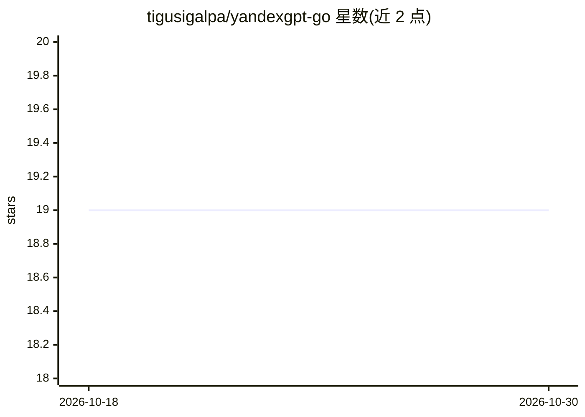

# tigusigalpa/yandexgpt-go

⭐ 19 · Go · MIT · 推送 2026-04-14 · [GitHub](https://github.com/tigusigalpa/yandexgpt-go) · [官网](https://pkg.go.dev/github.com/tigusigalpa/yandexgpt-go/v2) · 个人维护

**面向 YandexGPT/YandexART API 的 Go SDK**

为 YandexGPT API 提供的 Golang SDK：支持文本生成（YandexGPT、YandexGPT Lite、AliceAI LLM）、图像生成（YandexART）、对话管理与 Conversations API（服务端存储对话），并自动管理 OAuth/IAM 令牌，内部使用 yandex-cloud-client-go 处理 Yandex Cloud 的组织、云、目录与授权。提供推理模式（Chain of Thought，可调 Mode/Effort）、自定义生成参数与错误处理。流式传输暂不支持，需 Yandex Cloud 账号。通过 go get 安装，含测试与示例。

## 筛选速览

| 维度 | 判定 | 备注 |
|---|---|---|
| AI 角色 | `ai-ecosystem` | LLM/agent 周边工具 |
| 许可风险 | `permissive` | MIT |
| 部署形态 | `None` |  |
| 模型依赖 | — | README 未给出锁定关系 |
| 硬件要求 | — | 无带数字的原话,不猜 |
| 安装摩擦 | `low` | 无编译、无系统依赖或容器化 |
| 成熟度 | — | 结构信号不足 |

## 能力要点

- 文本生成与 YandexART 图像生成
- Conversations API 服务端对话管理（增删改查）
- 自动管理 OAuth/IAM 令牌，基于 yandex-cloud-client-go
- 推理模式（Chain of Thought，Mode/Effort 可配置）

## 适用场景

- 在 Go 服务中接入 YandexGPT 完成文本生成与对话
- 通过 Conversations API 在服务端管理对话历史
- 调用 YandexART 生成图像，与 Gin/Echo/gRPC 集成

## 场景标签

`图像生成` · 领域:内容生成

## 证据(README 行号)

> L13: Go SDK для YandexGPT API с поддержкой генерации текста и изображений (YandexART).
> L15: Пакет берёт на себя работу с токенами, предоставляет методы для диалогов, одиночных запросов и Conversations API.
> L22: - Генерация текста (YandexGPT, YandexGPT Lite, AliceAI LLM)
> L25: - Автоматическое управление OAuth/IAM токенами

## 星数曲线

2026-10-18 19 → 2026-10-30 19（+0）

---
*卡片 v1 · prompt 1.4 · 生成 2026-10-28 · 置信度 high · 依据 README sha `442d854fba2b` · [字段定义](../../DATASET.md)*
