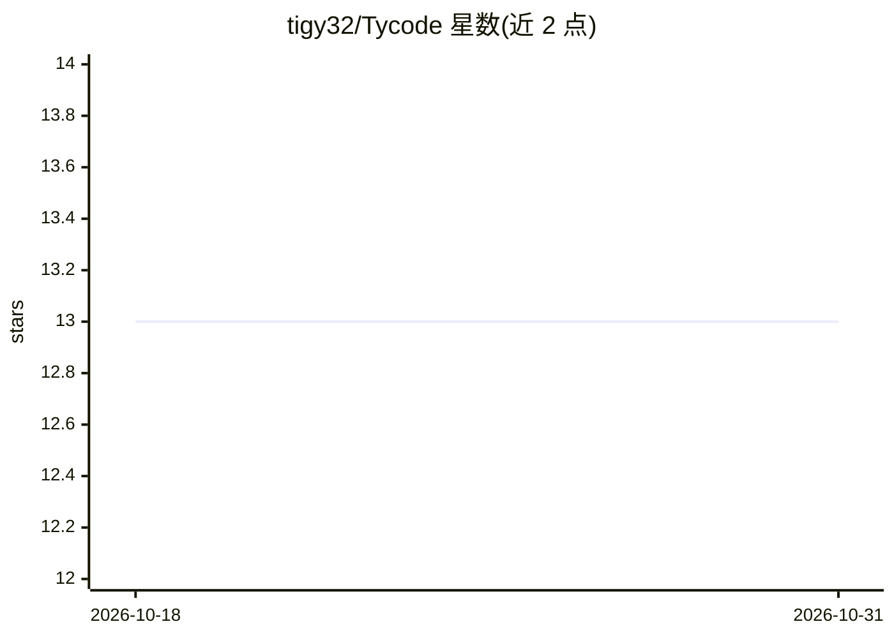

# tigy32/Tycode

⭐ 13 · Rust · MIT · 推送 2026-09-08 · [GitHub](https://github.com/tigy32/Tycode) · [官网](https://tycode.dev) · 个人维护

**自带 API Key 的 AI 编程助手，CLI 与 VSCode 扩展双形态**

Rust 实现的 AI 编程助手，以命令行工具与 VSCode 扩展两种形态交付，采用 bring-your-own-key 模式，费用直接支付给 AI 提供商（AWS Bedrock 或 OpenRouter）。内置 Bash 与文件工具，模型遵守 .gitignore 规则；提供成本分层控制（unlimited/low 等路由到不同档次模型）。兼容 Claude Code Agent Skills 技能目录与 SKILL.md 格式，支持 stdio/HTTP 两种传输的 MCP 服务器接入。需从源码构建：克隆仓库后运行打包脚本生成 CLI 与 VSIX 扩展包。

## 筛选速览

| 维度 | 判定 | 备注 |
|---|---|---|
| AI 角色 | `ai-native` | 本体是模型或模型工具 |
| 许可风险 | `permissive` | MIT |
| 部署形态 | `None` |  |
| 模型依赖 | locked-api |  |
| 硬件要求 | — | 无带数字的原话,不猜 |
| 安装摩擦 | `low` | 无编译、无系统依赖或容器化 |
| 成熟度 | — | 结构信号不足 |

## 能力要点

- CLI 与 VSCode 扩展双形态，bring-your-own-key 直连 Bedrock/OpenRouter
- 成本分层控制，按档位路由到不同档次模型
- 兼容 Claude Code Skills 格式（~/.claude/skills 与项目级目录）
- 支持 stdio 与 HTTP 传输的 MCP 服务器接入

## 适用场景

- 在终端或 VSCode 中用 AI 辅助编写代码
- 用自己的 Bedrock/OpenRouter 账号控制模型选择与费用
- 复用已有 Claude Code 技能目录与 MCP 服务器配置

## 场景标签

`编码 Agent` · 领域:编码与开发

## 证据(README 行号)

> L3: Tycode is an AI-powered coding assistant that operates as both a command-line tool and a Visual Studio Code extensio
> L37: You must configure an AI provider before using Tycode. Tycode supports token API providers: AWS Bedrock and OpenRou

## 星数曲线

2026-10-18 13 → 2026-10-31 13（+0）

---
*卡片 v1 · prompt 1.4 · 生成 2026-10-31 · 置信度 high · 依据 README sha `37d462764421` · [字段定义](../../DATASET.md)*
