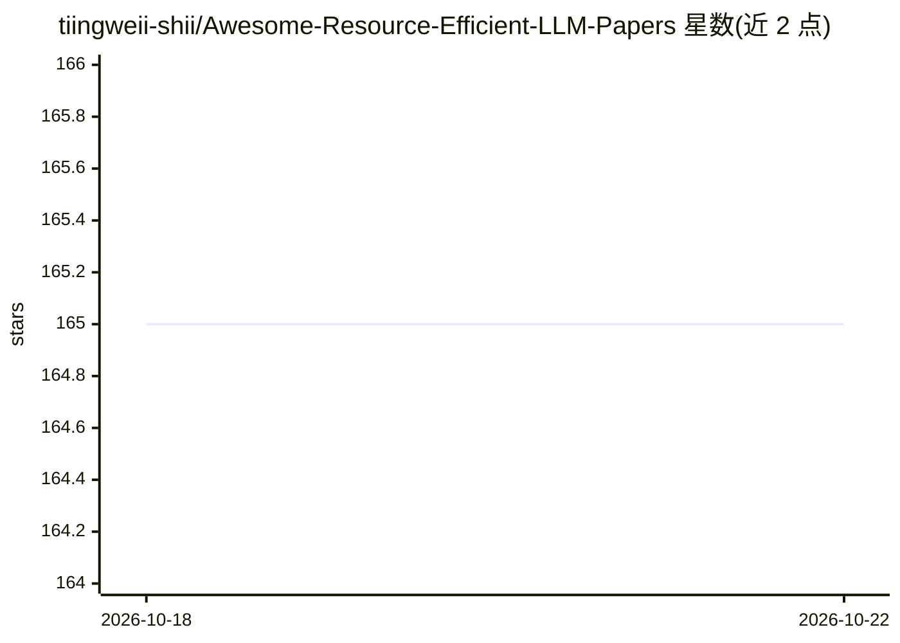

# tiingweii-shii/Awesome-Resource-Efficient-LLM-Papers

⭐ 165 · CC0-1.0 · 推送 2026-06-08 · [GitHub](https://github.com/tiingweii-shii/Awesome-Resource-Efficient-LLM-Papers) · 组织维护

**资源高效 LLM 论文策展清单，附系统综述**

一篇题为 Beyond Efficiency: A Systematic Survey of Resource-Efficient Large Language Models 的综述论文配套仓库，以表格形式按 LLM 架构设计、预训练（分布式训练、混合精度、数据效率）、微调（参数高效/全参数）、推理（模型压缩/剪枝）等类别组织资源高效 LLM 论文，条目含年份、关键词与发表会议。仓库持续更新，面向研究人员检索文献。

## 筛选速览

| 维度 | 判定 | 备注 |
|---|---|---|
| AI 角色 | `ai-knowledge` | 知识聚合/清单类 |
| 许可风险 | `viral` | CC0-1.0 |
| 部署形态 | `None` |  |
| 模型依赖 | — | README 未给出锁定关系 |
| 硬件要求 | — | 无带数字的原话,不猜 |
| 安装摩擦 | `low` | 无编译、无系统依赖或容器化 |
| 成熟度 | — | 结构信号不足 |

## 能力要点

- 覆盖架构、预训练、微调、推理等阶段的高效 LLM 论文分类
- 表格条目含日期、关键词、论文与发表会议
- 作为系统综述论文的配套代码仓库持续更新

## 适用场景

- 查找 LLM 训练/推理效率方向的论文
- 按主题类别浏览资源高效 LLM 研究脉络
- 作为综述论文的文献补充参考

## 场景标签

 · 领域:LLM 研究/知识聚合

## 证据(README 行号)

> L3:  A curated list of high-quality papers on resource-efficient LLMs. (constantly updated)
> L7: This is the GitHub repo for our survey paper Beyond Efficiency: A Systematic Survey of Resource-Efficient Large Lang

## 星数曲线

2026-10-18 165 → 2026-10-22 165（+0）

---
*卡片 v1 · prompt 1.4 · 生成 2026-10-22 · 置信度 high · 依据 README sha `496bd2e88464` · [字段定义](../../DATASET.md)*
