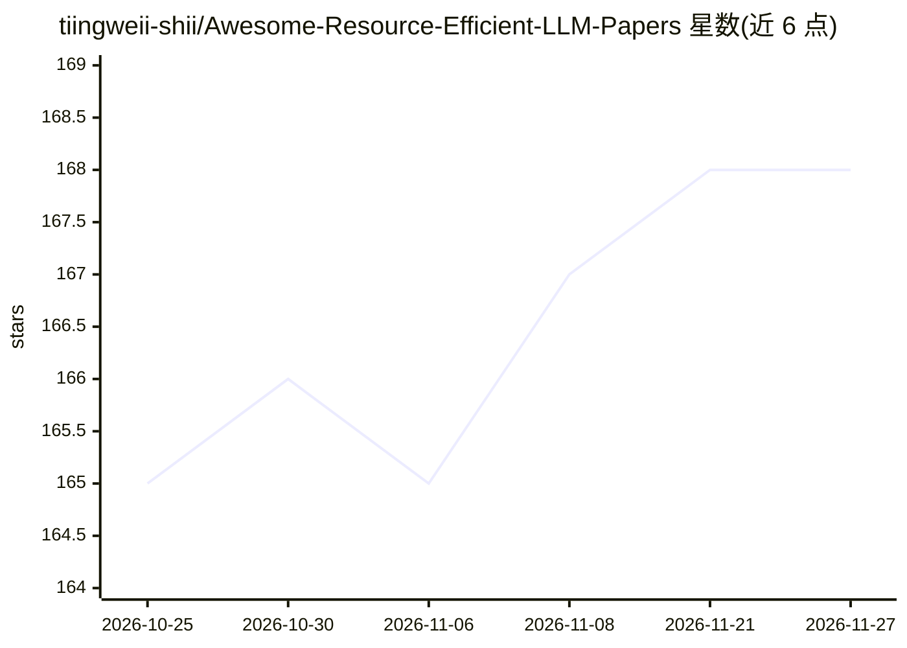

# tiingweii-shii/Awesome-Resource-Efficient-LLM-Papers

⭐ 168 · CC0-1.0 · 推送 2026-11-23 · [GitHub](https://github.com/tiingweii-shii/Awesome-Resource-Efficient-LLM-Papers) · 组织维护

**面向研究者的资源高效 LLM 论文策展清单**

配套 ACM Computing Survey 综述论文（Beyond Efficiency: A Systematic Survey of Resource-Efficient Large Language Models）维护的论文清单，持续更新。条目按 LLM 架构设计（高效 Transformer、非 Transformer 架构）、预训练（显存/数据效率、混合精度）、微调（参数高效/全参数）、推理（剪枝等模型压缩）分类，每条含年份、关键词、论文名与发表 venue，以表格形式组织。

## 筛选速览

| 维度 | 判定 | 备注 |
|---|---|---|
| AI 角色 | `ai-knowledge` | 知识聚合/清单类 |
| 许可风险 | `viral` | CC0-1.0 |
| 部署形态 | `None` |  |
| 模型依赖 | — | README 未给出锁定关系 |
| 硬件要求 | — | 无带数字的原话,不猜 |
| 安装摩擦 | `low` | 无编译、无系统依赖或容器化 |
| 成熟度 | — | 结构信号不足 |

## 能力要点

- 按架构设计/预训练/微调/推理四阶段组织论文条目
- 每条记录年份、关键词与发表 venue
- 配套发表于 ACM Computing Survey 的系统性综述
- 标注为持续更新（constantly updated）

## 适用场景

- 查找特定阶段（预训练/微调/推理）的效率优化论文
- 按关键词快速定位 LoRA、Mixture-of-Experts、剪枝等主题文献
- 了解资源高效 LLM 方向的综述脉络

## 场景标签

`精选清单` · 领域:学习与行业

## 证据(README 行号)

> L3:  A curated list of high-quality papers on resource-efficient LLMs. (constantly updated)
> L7: This is the GitHub repo for our survey paper Beyond Efficiency: A Systematic Survey of Resource-Efficient Large Lang
> L13:  ## LLM Architecture Design

## 星数曲线

2026-10-25 165 → 2026-11-27 168（+3）

---
*卡片 v1 · prompt 1.4 · 生成 2026-11-26 · 置信度 high · 依据 README sha `c60adeba8e97` · [字段定义](../../DATASET.md)*
