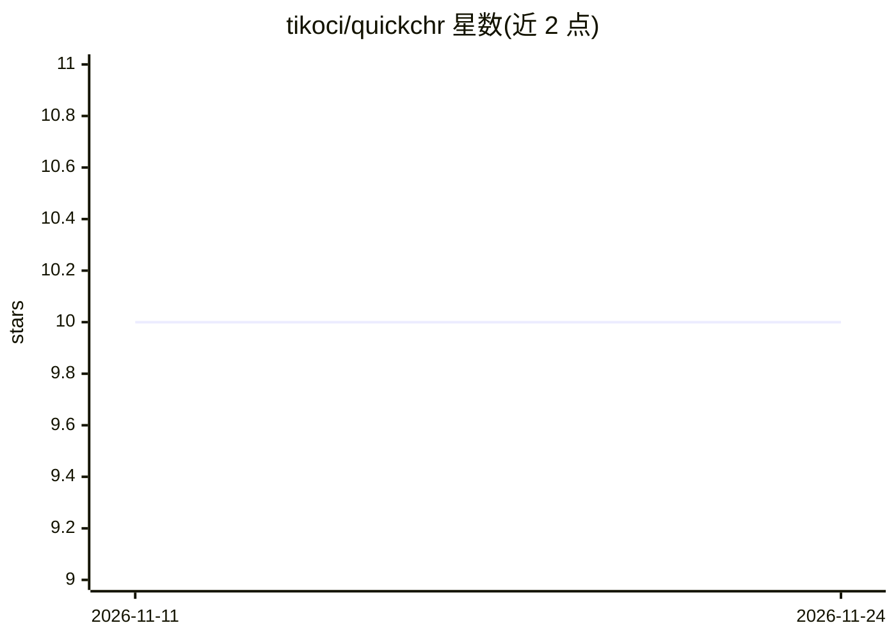

# tikoci/quickchr

⭐ 10 · TypeScript · MIT · 推送 2026-11-21 · [GitHub](https://github.com/tikoci/quickchr) · [官网](https://tikoci.github.io/p/quickchr) · 个人维护

**面向测试与脚本的 MikroTik CHR 虚拟机快速启动管理 CLI**

基于 Bun 与 QEMU 的 CLI 和库，用于下载、启动和管理 MikroTik RouterOS CHR 虚拟机：提供交互式 setup 向导与脚本化 flags、qcow2/raw 磁盘管理、快照、多 NIC 网络（SLIRP/shared/bridged/socket/tap）、按实例分配 10 端口块的服务映射（WebFig/SSH/API/WinBox），以及 `inspect` 输出版本化 JSON 描述符供子进程（如 agent）连接。区分 boot-only 功能与仅支持 RouterOS 7.20.8+ 的开机后配置（用户、许可、device-mode）。

## 筛选速览

| 维度 | 判定 | 备注 |
|---|---|---|
| AI 角色 | `ai-enhanced` | 去掉 AI 部分产品仍成立 |
| 许可风险 | `permissive` | MIT |
| 部署形态 | `None` |  |
| 模型依赖 | — | README 未给出锁定关系 |
| 硬件要求 | — | 无带数字的原话,不猜 |
| 安装摩擦 | `low` | 无编译、无系统依赖或容器化 |
| 成熟度 | — | 结构信号不足 |

## 能力要点

- 交互式向导与全 flag 脚本化两种使用方式
- 每实例分配 10 端口块并支持自定义 hostfwd 端口映射
- 输出版本化 JSON 机器描述符与子进程环境变量供外部进程连接
- 后台运行 QEMU 为 OS 级孤儿进程，支持 stop/shutdown 两种关闭路径

## 适用场景

- 为网络测试脚本快速拉起临时 RouterOS CHR 实例
- 在 CI 或 agent 会话中托管并管理多台 CHR
- 模拟多路由器共享 L2 的组网实验

## 场景标签

 · 领域:网络/基础设施测试工具

## 证据(README 行号)

> L3: CLI and library to download, launch, and manage MikroTik CHR virtual machines via QEMU.
> L32: Running in a Claude Code cloud session or another proxied sandbox with no KVM? See

## 星数曲线

2026-11-11 10 → 2026-11-24 10（+0）

---
*卡片 v1 · prompt 1.4 · 生成 2026-11-19 · 置信度 high · 依据 README sha `b0fe9ea7548e` · [字段定义](../../DATASET.md)*
