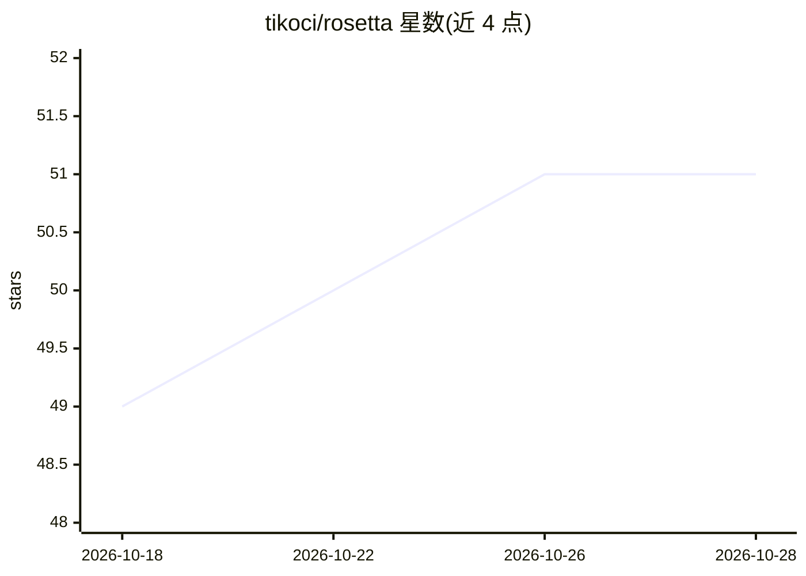

# tikoci/rosetta

⭐ 51 · TypeScript · MIT · 推送 2026-10-28 · [GitHub](https://github.com/tikoci/rosetta) · [官网](https://tikoci.github.io/p/rosetta) · 个人维护

**让 AI 助手检索 MikroTik RouterOS 文档的 MCP 服务器**

面向 AI 助手的 MCP server，将 MikroTik RouterOS 的文档页（369 页）、CLI Reference 属性字段（2,799+10,833 条）、命令树（5,333 条命令）、67 个版本历史、155+258 台硬件规格与价格、3,162 条性能测试、746 个视频转录等数据聚合进单个 SQLite 数据库，检索层采用 SQLite FTS5 全文搜索（BM25 + porter 词干）而非向量嵌入，无需 API key 与向量库。可在 RouterOS 7.22+ 路由器上以 /app 容器方式部署供局域网内任意 MCP 客户端使用，也可在本地用 Bun 以 stdio 运行；另附无需 AI 的终端浏览界面。文档仅覆盖 RouterOS v7。

## 筛选速览

| 维度 | 判定 | 备注 |
|---|---|---|
| AI 角色 | `ai-ecosystem` | LLM/agent 周边工具 |
| 许可风险 | `permissive` | MIT |
| 部署形态 | `None` |  |
| 模型依赖 | — | README 未给出锁定关系 |
| 硬件要求 | — | 无带数字的原话,不猜 |
| 安装摩擦 | `low` | 无编译、无系统依赖或容器化 |
| 成熟度 | — | 结构信号不足 |

## 能力要点

- SQL-as-RAG：SQLite FTS5 全文检索替代向量嵌入，无需 API key
- 聚合文档/CLI 属性/命令树/硬件规格/性能测试/视频转录为单一 SQLite 库
- 支持 RouterOS /app 容器部署，局域网内任意 HTTP MCP 客户端可接入
- 内置终端卡片目录式浏览器，无需 AI 助手即可检索全部数据源

## 适用场景

- 网络管理员让 AI 助手查询 RouterOS 命令用法与属性定义
- 跨 RouterOS 版本比对命令树差异与破坏性变更
- 直接在终端检索 MikroTik 硬件规格、性能测试与变更日志

## 场景标签

`RAG` · 领域:知识与检索

## 证据(README 行号)

> L3: MCP server that gives AI assistants searchable access to MikroTik RouterOS documentation, CLI Reference fields, vers
> L9: Instead of vector embeddings, rosetta uses **SQLite FTS5 full-text search** as the retrieval layer — SQL-as-RAG. For

## 星数曲线

2026-10-18 49 → 2026-10-28 51（+2）

---
*卡片 v1 · prompt 1.4 · 生成 2026-10-24 · 置信度 high · 依据 README sha `408b8c00d447` · [字段定义](../../DATASET.md)*
