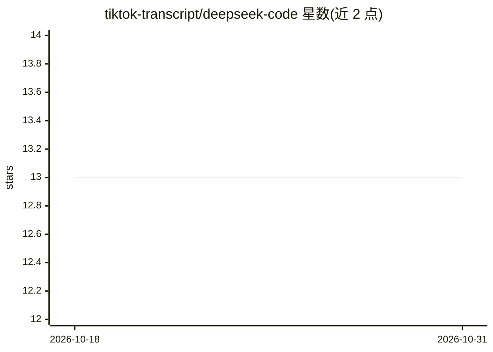

# tiktok-transcript/deepseek-code

⭐ 13 · 推送 2026-09-22 · [GitHub](https://github.com/tiktok-transcript/deepseek-code) · [官网](https://begin.sh?utm_source=github&utm_medium=ugc&utm_campaign=deepseek-code&utm_content=readme-top&utm_term=tier-r) · 个人维护

**非官方指南：DeepSeek Deep Code CLI 与 DeepSeek Coder 模型的使用说明**

社区维护的实用指南（非 DeepSeek 官方），厘清两个易混淆事物：Deep Code 是开源终端 AI 编码助手（npm 包 @vegamo/deepcode-cli），通过 API key 调用 DeepSeek-V4 托管模型，支持深度思考、推理力度控制与 Agent Skills；DeepSeek Coder 是 1.3B/6.7B/33B 开源权重编码模型，可经 Ollama 本地运行（16K 上下文、纯文本，条目两年未更新）。指南给出安装配置步骤、配置项表、价格与常见陷阱，并附与 Begin.sh 的对比表。

## 筛选速览

| 维度 | 判定 | 备注 |
|---|---|---|
| AI 角色 | `ai-knowledge` | 知识聚合/清单类 |
| 许可风险 | `none` | — |
| 部署形态 | `library` | 以包/库形式分发 |
| 模型依赖 | local-ok | 支持本地模型 |
| 硬件要求 | — | 无带数字的原话,不猜 |
| 安装摩擦 | `low` | 无编译、无系统依赖或容器化 |
| 成熟度 | — | 结构信号不足 |

## 能力要点

- 区分 Deep Code CLI 与 DeepSeek Coder 两个产品及各自运行方式
- settings.json 配置项文档（MODEL/BASE_URL/thinkingEnabled/reasoningEffort 等）
- Ollama 本地运行 deepseek-coder 三个尺寸变体的命令与 API 端点说明
- FAQ 与实用陷阱（API key 明文存储、勿混用两个产品等）

## 适用场景

- 我搜索 deepseek code 时想弄清 CLI 工具和本地模型的区别
- 我想配置 Deep Code CLI 连接 DeepSeek-V4 API
- 我想用 Ollama 本地跑 DeepSeek Coder 模型

## 场景标签

`教程课程` · 领域:学习与行业

## 证据(README 行号)

> L3: *Unofficial community guide for DeepSeek Code. Not affiliated with DeepSeek. All trademarks belong to their owners.*
> L5: People searching for "deepseek code" usually mean one of two things: Deep Code, the open-source terminal coding assi

## 星数曲线

2026-10-18 13 → 2026-10-31 13（+0）

---
*卡片 v1 · prompt 1.4 · 生成 2026-10-31 · 置信度 high · 依据 README sha `4cc5f26df93e` · [字段定义](../../DATASET.md)*
