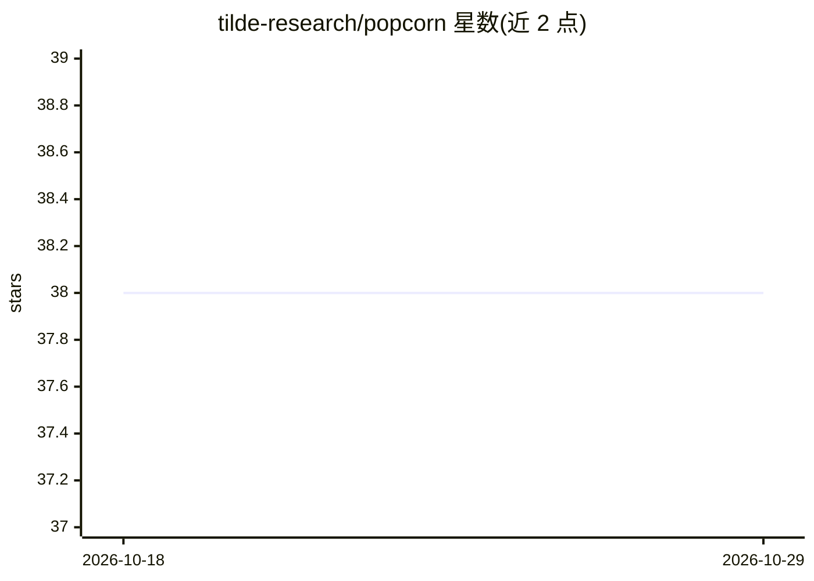

# tilde-research/popcorn

⭐ 38 · Python · Apache-2.0 · 推送 2026-08-15 · [GitHub](https://github.com/tilde-research/popcorn) · [官网](https://tilde-research.github.io/popcorn/) · 个人维护

**PyTorch 高性能 ML kernel 的开发与自动分发调度库**

面向机器学习 kernel 开发者的 Python 库：将 96 个 kernel、100 余个优化实现统一在单一 API 之后，依据硬件相关的基准测试记录在可用后端间自动分发选择；每个实现均与 PyTorch 参考实现比对，未通过或未测量的用例保持可见而非视为已验证。附带第一方 kernel 集合及构建、测试、基准测试与部署新 kernel/后端的环境。正确性仅定义为与参考实现的一致性，分发以记录执行时间为优化目标而非峰值内存，各后端 extra 互斥不可同时安装。

## 筛选速览

| 维度 | 判定 | 备注 |
|---|---|---|
| AI 角色 | `ai-ecosystem` | LLM/agent 周边工具 |
| 许可风险 | `permissive` | Apache-2.0 |
| 部署形态 | `library` | 以包/库形式分发 |
| 模型依赖 | — | README 未给出锁定关系 |
| 硬件要求 | — | 无带数字的原话,不猜 |
| 安装摩擦 | `low` | 无编译、无系统依赖或容器化 |
| 成熟度 | — | 结构信号不足 |

## 能力要点

- 96 个 kernel 与 100+ 优化实现统一在单一 API 后
- 基于硬件基准记录在后端间自动分发选择
- 实现与 PyTorch 参考比对，失败与未测量用例保持可见
- 提供构建、测试、基准与部署新 kernel 的环境与 harness

## 适用场景

- 在多个 kernel 后端（Liger/FLA/cuDNN 等）间自动选择适配硬件的实现
- 开发并基准测试自定义机器学习 kernel 与后端
- 比较不同 kernel 实现在同硬件上的执行时间

## 场景标签

 · 领域:机器学习基础设施/kernel 优化

## 证据(README 行号)

> L15: ***Popcorn*** 🍿 is a development and dispatch library for high-performance machine learning kernels. It unifies **9
> L16: Popcorn also ships a growing collection of first-party kernels, along with the environment and harness to build, te

## 星数曲线

2026-10-18 38 → 2026-10-29 38（+0）

---
*卡片 v1 · prompt 1.4 · 生成 2026-10-25 · 置信度 high · 依据 README sha `25358eb448f9` · [字段定义](../../DATASET.md)*
