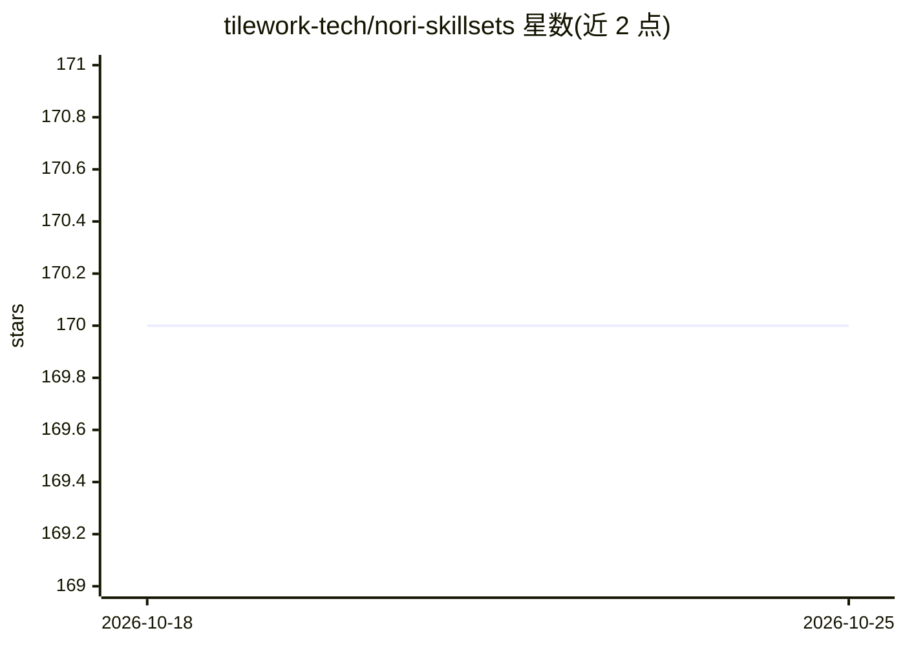

# tilework-tech/nori-skillsets

⭐ 170 · TypeScript · Apache-2.0 · 推送 2026-10-03 · [GitHub](https://github.com/tilework-tech/nori-skillsets) · [官网](https://www.npmjs.com/package/nori-skillsets) · 组织维护

**面向编码 agent 的技能集安装与切换管理 CLI**

Nori Skillsets Client 是一个 npm 安装的全局 CLI，连接 noriskillsets.dev 注册表，下载并管理经过审核的 agent Skillset（技能、AGENTS.md/CLAUDE.md、子代理、斜杠命令、MCP 服务器配置）。核心机制是将同一 Skillset 翻译为各 agent 期望的磁盘格式并写入对应目录，支持一次面向多个 agent（Claude Code、Cursor、Codex、Gemini CLI 等 12 种）切换配置而不丢失原配置；提供跨 agent 内联标记语法与团队私有注册表。要求 Node.js 22+、Mac/Linux 及至少一个受支持的 agent CLI。

## 筛选速览

| 维度 | 判定 | 备注 |
|---|---|---|
| AI 角色 | `ai-ecosystem` | LLM/agent 周边工具 |
| 许可风险 | `permissive` | Apache-2.0 |
| 部署形态 | `library` | 以包/库形式分发 |
| 模型依赖 | — | README 未给出锁定关系 |
| 硬件要求 | — | 无带数字的原话,不猜 |
| 安装摩擦 | `low` | 无编译、无系统依赖或容器化 |
| 成熟度 | — | 结构信号不足 |

## 能力要点

- 从 noriskillsets.dev 注册表下载经审核的 Skillset 与单个 Skill
- 同一 Skillset 翻译为 12 种编码 agent 各自的磁盘格式
- 多 Skillset 库存管理与无损切换（~/.nori/profiles）
- 跨 agent 内联条件标记语法（{{claude-code …}}{{codex …}}）

## 适用场景

- 在多个编码 agent 之间共享并同步同一套行为配置
- 按项目切换不同的 agent 技能集与工作流
- 团队通过私有注册表统一分发内部配置

## 场景标签

 · 领域:AI 开发者工具/agent 配置管理

## 证据(README 行号)

> L8: **CLI Client for installing and managing Nori Skillsets**
> L12: The client supports a wide range of coding agents (Claude Code, Cursor, Codex, Gemini CLI, GitHub Copilot, OpenCode
> L69: 2. Translates the skillset into the format each agent expects and writes it to the corresponding agent directory

## 星数曲线

2026-10-18 170 → 2026-10-25 170（+0）

---
*卡片 v1 · prompt 1.4 · 生成 2026-10-22 · 置信度 high · 依据 README sha `23b4822382b8` · [字段定义](../../DATASET.md)*
