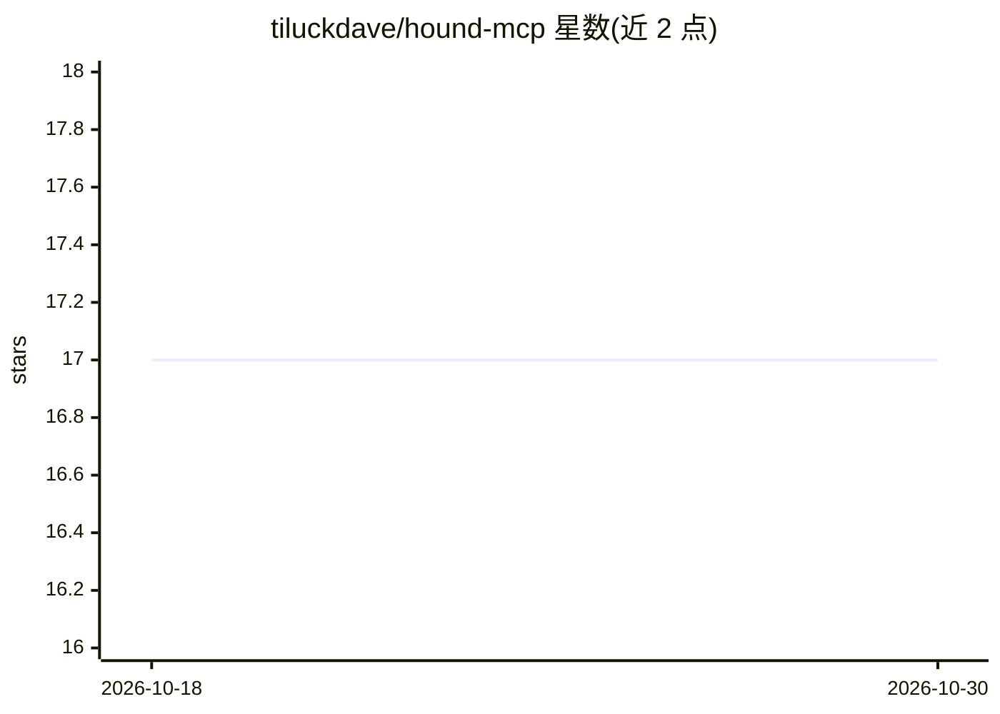

# tiluckdave/hound-mcp

⭐ 17 · TypeScript · MIT · 推送 2026-10-28 · [GitHub](https://github.com/tiluckdave/hound-mcp) · [官网](https://npmjs.com/package/hound-mcp) · 个人维护

**面向 AI 编码 agent 的 MCP 依赖安全扫描服务器**

一个 Model Context Protocol 服务器，供 AI 编码代理在安装或推荐软件包前查询依赖安全信息。提供 12 个工具，覆盖 lockfile 漏洞扫描、0-100 打分、两包对比、GO/CAUTION/NO-GO 预安装判定、最小安全升级版本查找、许可证合规检查、typosquat 检测等，支持 npm/PyPI/Go/Maven/Cargo/NuGet/RubyGems 七个生态。数据来自 deps.dev 与 OSV 两个公开免费 API，无需账号、API key 或付费方案。通过 npx 安装并接入 Claude Code、Cursor、VS Code 等 MCP 客户端。

## 筛选速览

| 维度 | 判定 | 备注 |
|---|---|---|
| AI 角色 | `ai-ecosystem` | LLM/agent 周边工具 |
| 许可风险 | `permissive` | MIT |
| 部署形态 | `library` | 以包/库形式分发 |
| 模型依赖 | — | README 未给出锁定关系 |
| 硬件要求 | — | 无带数字的原话,不猜 |
| 安装摩擦 | `low` | 无编译、无系统依赖或容器化 |
| 成熟度 | — | 结构信号不足 |

## 能力要点

- 12 个 MCP 工具：漏洞扫描、依赖审计、许可证检查、typosquat 检测
- 覆盖 npm/PyPI/Go/Maven/Cargo/NuGet/RubyGems 七个包生态
- 仅依赖 deps.dev 与 OSV 公开免费 API，零配置零 API key
- 提供 GO/CAUTION/NO-GO 预安装判定与最小安全升级版本查找

## 适用场景

- 合并 PR 前扫描 lockfile 变更中的新增漏洞
- 添加依赖前获得安装与否的判定建议
- 检查商业项目中是否混入 GPL/AGPL 许可证包
- 作为 CI 发布流程中的安全检查步骤

## 场景标签

`网络安全` · 领域:学习与行业

## 证据(README 行号)

> L14: AI coding agents recommend and install packages without knowing if they're safe — and most security tools require a
> L16: Hound is the only security tool built specifically for AI coding agents — works across npm, PyPI, Go, Cargo, Maven,
> L18: It uses two fully free, unauthenticated public APIs: **deps.dev** (Google Open Source Insights) and **OSV** (Google

## 星数曲线

2026-10-18 17 → 2026-10-30 17（+0）

---
*卡片 v1 · prompt 1.4 · 生成 2026-10-29 · 置信度 mid · 依据 README sha `069c5693c1ec` · [字段定义](../../DATASET.md)*
