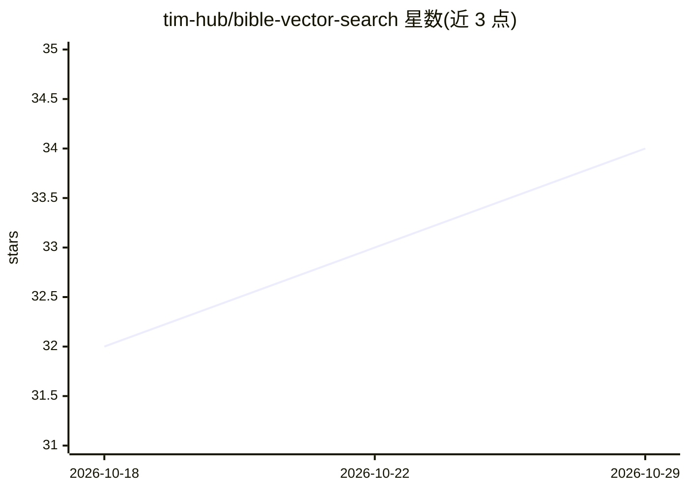

# tim-hub/bible-vector-search

⭐ 34 · TypeScript · MIT · 推送 2026-10-27 · [GitHub](https://github.com/tim-hub/bible-vector-search) · [官网](https://antiochtech-bible-search.bai.uno) · 个人维护

**基于嵌入与向量库的圣经经文语义搜索工具**

面向圣经研读用户与开发者的经文搜索项目：使用 AI Embedding 与向量数据库技术栈，对 BBE 译本经文建立语义检索，支持按含义而非关键词查找经文。提供线上站点与 API 接口可访问。README 仅含简介与访问地址，未展示安装步骤、技术栈细节或本地部署说明。

## 筛选速览

| 维度 | 判定 | 备注 |
|---|---|---|
| AI 角色 | `ai-native` | 本体是模型或模型工具 |
| 许可风险 | `permissive` | MIT |
| 部署形态 | `None` |  |
| 模型依赖 | — | README 未给出锁定关系 |
| 硬件要求 | — | 无带数字的原话,不猜 |
| 安装摩擦 | `low` | 无编译、无系统依赖或容器化 |
| 成熟度 | — | 结构信号不足 |

## 能力要点

- 使用 AI Embedding 与向量数据库实现语义搜索
- 支持按含义而非关键词检索经文（BBE 译本）
- 提供公开站点与 API 接口

## 适用场景

- 按语义含义查找相关圣经经文
- 通过 API 将经文语义检索接入其他应用

## 场景标签

`语义搜索` · 领域:知识与检索

## 证据(README 行号)

> L8: This is a simple Bible verse search tool to use AI Embedding and Vector Database stacks to provide a search engine f
> L9: It provides a way to search verses in its meanings not in keywords.

## 星数曲线

2026-10-18 32 → 2026-10-29 34（+2）

---
*卡片 v1 · prompt 1.4 · 生成 2026-10-25 · 置信度 high · 依据 README sha `388a5252245d` · [字段定义](../../DATASET.md)*
