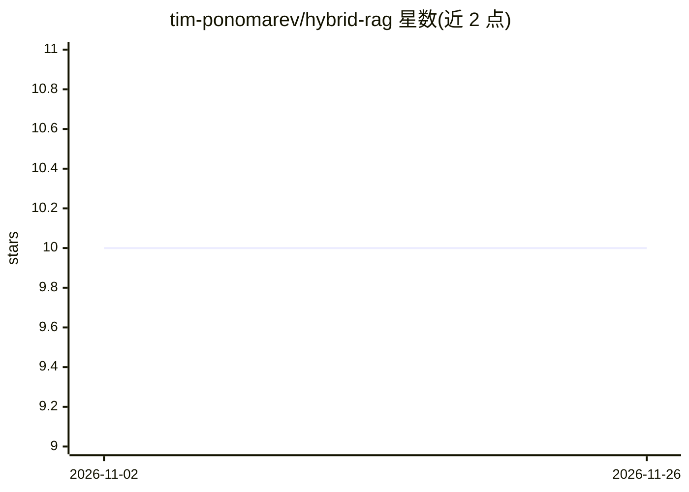

# tim-ponomarev/hybrid-rag

⭐ 10 · Python · 推送 2026-04-12 · [GitHub](https://github.com/tim-ponomarev/hybrid-rag) · 个人维护

**混合检索 RAG 管线：BM25+稠密检索+重排+LLM 评估**

提供生产环境的混合 RAG 检索管线：BM25 关键词检索与稠密向量检索并行，经 RRF 融合候选，再用交叉编码器对 top-50 候选重排；支持 Qdrant 作为向量后端，并内置 LLM-as-Judge 评估，从 faithfulness/relevance/coverage 三个维度给答案打分，另有 5 个 few-shot 校准示例。作者为独立 B2B ML 工程师，README 含 LegalBench 子集上的基准数据、架构图、分块策略与常见陷阱说明。提供无网络无 API key 的内存冒烟测试快速启动。

## 筛选速览

| 维度 | 判定 | 备注 |
|---|---|---|
| AI 角色 | `ai-ecosystem` | LLM/agent 周边工具 |
| 许可风险 | `none` | — |
| 部署形态 | `library` | 以包/库形式分发 |
| 模型依赖 | — | README 未给出锁定关系 |
| 硬件要求 | — | 无带数字的原话,不猜 |
| 安装摩擦 | `low` | 无编译、无系统依赖或容器化 |
| 成熟度 | — | 结构信号不足 |

## 能力要点

- BM25 + 稠密检索经 Reciprocal Rank Fusion 融合
- 交叉编码器（ms-marco）仅重排 top-50 候选以控制延迟
- LLM-as-Judge 从 faithfulness/relevance/coverage 三轴评分
- 提供无 Qdrant/无网络/无 API key 的 5 秒内存冒烟测试

## 适用场景

- 企业文档问答中对精确编号/代码类查询需要召回
- 法务或技术语料库的检索质量评估与调优
- 对比 BM25/稠密/混合/重排各管线的 nDCG 与延迟

## 场景标签

`RAG` · 领域:知识与检索

## 证据(README 行号)

> L3: **Production-grade hybrid RAG pipeline with BM25 + dense retrieval, cross-encoder re-ranking, and LLM-as-Judge evalu
> L91: │   ├── ingest.py          # Document chunking + indexing (Qdrant + BM25)

## 星数曲线

2026-11-02 10 → 2026-11-26 10（+0）

---
*卡片 v1 · prompt 1.4 · 生成 2026-11-19 · 置信度 mid · 依据 README sha `590976cf4547` · [字段定义](../../DATASET.md)*
