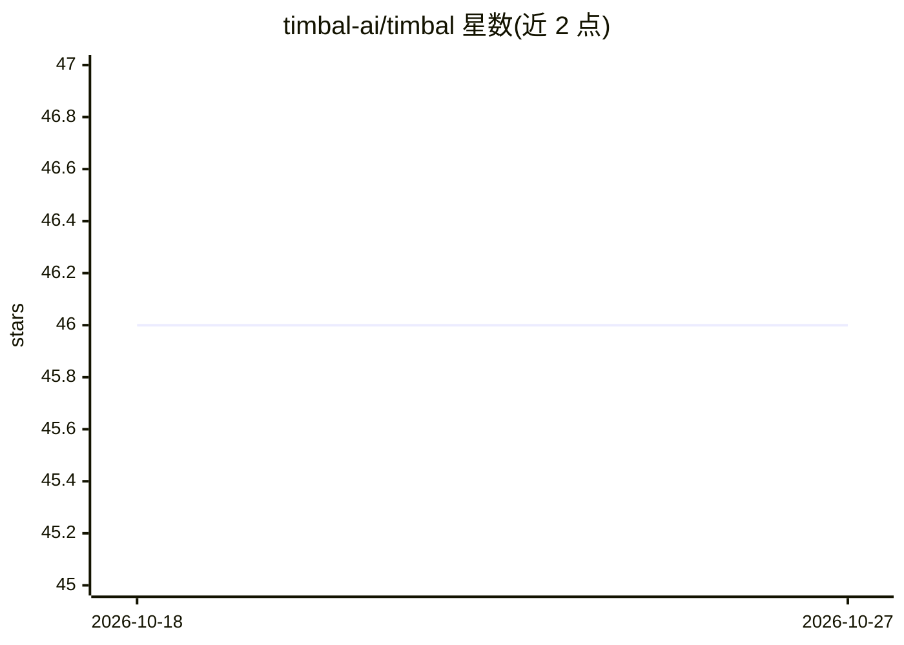

# timbal-ai/timbal

⭐ 46 · Python · Apache-2.0 · 推送 2026-10-26 · [GitHub](https://github.com/timbal-ai/timbal) · [官网](https://timbal.ai) · 组织维护

**构建可靠 AI 应用的 Python Agent/Workflow 框架**

Timbal 是一个构建 AI 应用的 Python 框架，提供 Agents（自主推理）与 Workflows（显式流水线）两种抽象，统一调用约定与事件流；基于 async 函数、Pydantic 校验和事件驱动流式处理。功能包括内存与上下文压缩、工具库与 MCP 接入、结构化输出、OTLP 追踪、YAML 评测套件、人工审批与挂起恢复。通过 pip 安装，支持 anthropic/openai 等多提供商及 FallbackModel 故障切换，可本地运行或部署到 Timbal 平台/自托管。核心框架代码量标注为 1 万行以内。

## 筛选速览

| 维度 | 判定 | 备注 |
|---|---|---|
| AI 角色 | `ai-ecosystem` | LLM/agent 周边工具 |
| 许可风险 | `permissive` | Apache-2.0 |
| 部署形态 | `library` | 以包/库形式分发 |
| 模型依赖 | — | README 未给出锁定关系 |
| 硬件要求 | — | 无带数字的原话,不猜 |
| 安装摩擦 | `low` | 无编译、无系统依赖或容器化 |
| 成熟度 | — | 结构信号不足 |

## 能力要点

- Agents 与 Workflows 共享同一调用约定与事件流
- 人工在环：审批门与 suspend() 可跨进程重启持久化恢复
- Provider 无关，FallbackModel 跨提供商自动故障切换
- 内置 Tracing（OTLP 导出）、Evals、Skills 与 MCP 工具接入

## 适用场景

- 用 Python 构建多步 Agent 或显式工作流应用
- 需要人工审批门与可恢复执行的生产级流程
- 对比框架开销后选择低开销的 Agent 运行时

## 场景标签

`Agent 框架` · 领域:Agent 开发

## 证据(README 行号)

> L9: Timbal gives you **Agents** (autonomous reasoning) and **Workflows** (explicit pipelines) behind one interface. No h
> L41: **The most performant agent framework.** In overhead benchmarks against LangGraph, CrewAI, the OpenAI Agents SDK, P

## 星数曲线

2026-10-18 46 → 2026-10-27 46（+0）

---
*卡片 v1 · prompt 1.4 · 生成 2026-10-25 · 置信度 high · 依据 README sha `96b30b083a36` · [字段定义](../../DATASET.md)*
