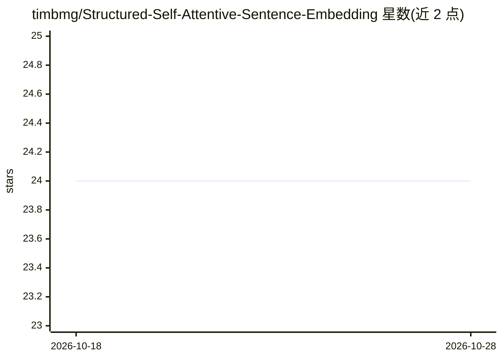

# timbmg/Structured-Self-Attentive-Sentence-Embedding

⭐ 24 · Python · 推送 2026-06-10 · [GitHub](https://github.com/timbmg/Structured-Self-Attentive-Sentence-Embedding) · [官网](https://arxiv.org/pdf/1703.03130.pdf) · 个人维护

**Lin et al. 2017 自注意力句子嵌入论文的 PyTorch 复现**

用 PyTorch 复现《A Structured Self-Attentive Sentence Embedding》（Lin et al., 2017）：在 Yelp 数据集上训练带结构化自注意力的 BiLSTM/RNN 模型做文本分类，5 个 epoch 后训练集准确率 77.26%、验证集 60.91%（训练集仅 2 万条，远小于论文规模）。提供训练脚本与可视化脚本：生成含注意力模式的 HTML 和混淆矩阵。与论文的差异包括用 Adam 代替 SGD、无梯度裁剪、无 dropout、无 GloVe 初始化。基于 Python 3.6.5，依赖见 requirements.txt。

## 筛选速览

| 维度 | 判定 | 备注 |
|---|---|---|
| AI 角色 | `ai-native` | 本体是模型或模型工具 |
| 许可风险 | `none` | — |
| 部署形态 | `None` |  |
| 模型依赖 | — | README 未给出锁定关系 |
| 硬件要求 | — | 无带数字的原话,不猜 |
| 安装摩擦 | `low` | 无编译、无系统依赖或容器化 |
| 成熟度 | — | 结构信号不足 |

## 能力要点

- PyTorch 复现结构化自注意力句子嵌入模型
- 在 Yelp 数据集上训练文本/情感分类
- 生成注意力模式 HTML 可视化与混淆矩阵
- README 明确列出与原论文的实现差异

## 适用场景

- 研究者验证或对照 Lin et al. 2017 的复现结果
- 学习自注意力句子嵌入的实现细节
- 分析模型在 Yelp 评论上的注意力模式

## 场景标签

 · 领域:NLP/深度学习

## 证据(README 行号)

> L2: Re-Implementation of _A Structured Self-Attentive Sentence Embedding_ by Lin et al., 2017.
> L19: `python3 train.py --data-dir <dir of unzipped yelp data>`

## 星数曲线

2026-10-18 24 → 2026-10-28 24（+0）

---
*卡片 v1 · prompt 1.4 · 生成 2026-10-27 · 置信度 high · 依据 README sha `611578cc3cd6` · [字段定义](../../DATASET.md)*
