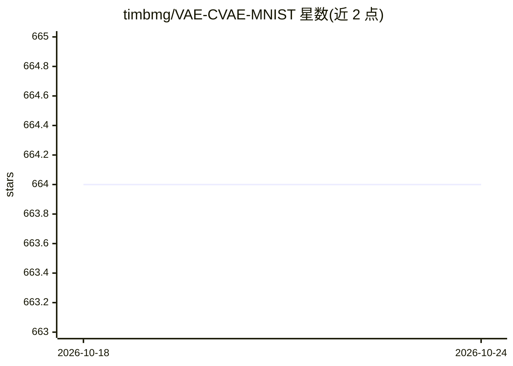

# timbmg/VAE-CVAE-MNIST

⭐ 664 · Python · 推送 2026-07-17 · [GitHub](https://github.com/timbmg/VAE-CVAE-MNIST) · 个人维护

**PyTorch 实现的 MNIST 变分自编码器与条件变分自编码器**

在 PyTorch 中实现变分自编码器（VAE）与条件变分自编码器（CVAE），在 MNIST 数据集上训练与采样。对应论文为 Auto-Encoding Variational Bayes 与 Semi-supervised Learning with Deep Generative Models。通过命令行参数 --conditional 切换条件版本，超参数（学习率、批大小、编码器/解码器层数与宽度）在代码中设置。README 展示默认设置训练 10 个 epoch 后的隐变量分布与生成采样结果，超参数未调优。

## 筛选速览

| 维度 | 判定 | 备注 |
|---|---|---|
| AI 角色 | `ai-native` | 本体是模型或模型工具 |
| 许可风险 | `none` | — |
| 部署形态 | `None` |  |
| 模型依赖 | — | README 未给出锁定关系 |
| 硬件要求 | — | 无带数字的原话,不猜 |
| 安装摩擦 | `low` | 无编译、无系统依赖或容器化 |
| 成熟度 | — | 结构信号不足 |

## 能力要点

- PyTorch 实现 VAE 与 CVAE 两种模型
- MNIST 数据集上训练与隐空间采样可视化
- 命令行参数切换条件版本与配置超参数

## 适用场景

- 学习/复现 VAE 与 CVAE 论文方法
- 作为变分自编码器的代码参考实现

## 场景标签

`教程课程` · 领域:学习与行业

## 证据(README 行号)

> L1: # Variational Autoencoder & Conditional Variational Autoenoder on MNIST
> L7: In order to run _conditional_ variational autoencoder, add `--conditional` to the the command. Check out the other c

## 星数曲线

2026-10-18 664 → 2026-10-24 664（+0）

---
*卡片 v1 · prompt 1.4 · 生成 2026-10-21 · 置信度 mid · 依据 README sha `2c5e08283e62` · [字段定义](../../DATASET.md)*
