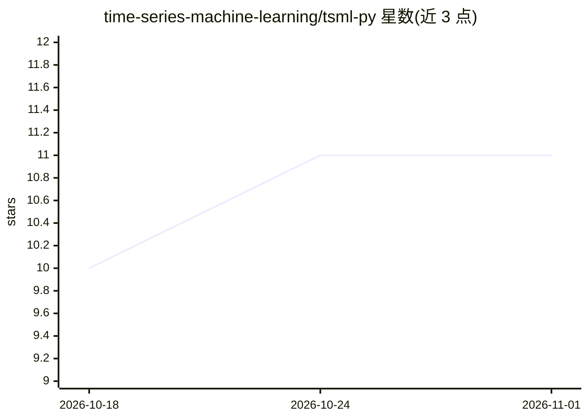

# time-series-machine-learning/tsml-py

⭐ 11 · Python · BSD-3-Clause · 推送 2026-10-26 · [GitHub](https://github.com/time-series-machine-learning/tsml-py) · 个人维护

**时间序列机器学习算法的实验性 Python 工具箱**

由 Matthew Middlehurst 维护的时间序列机器学习算法仓库，定位为开发和测试新算法的沙盒：存放尚未进入 aeon 或 tsml_eval 等成熟工具包的算法与实现，README 明确建议优先使用 aeon。当前发布版本为 v0.10.0，通过 PyPI 以 pip install tsml 安装。研究工作受英国 EPSRC 项目 EP/W030756/1 支持。覆盖分类、聚类、回归等时间序列任务方向的算法实现。

## 筛选速览

| 维度 | 判定 | 备注 |
|---|---|---|
| AI 角色 | `ai-native` | 本体是模型或模型工具 |
| 许可风险 | `permissive` | BSD-3-Clause |
| 部署形态 | `library` | 以包/库形式分发 |
| 模型依赖 | — | README 未给出锁定关系 |
| 硬件要求 | — | 无带数字的原话,不猜 |
| 安装摩擦 | `low` | 无编译、无系统依赖或容器化 |
| 成熟度 | `idea` | |

## 能力要点

- 收录处于开发阶段、尚未进入 aeon/tsml_eval 的时间序列算法
- 当前版本 v0.10.0，pip 可安装
- 与 scikit-learn 生态相关的 Python 工具箱

## 适用场景

- 尝试尚未进入主流工具包的新时间序列算法
- 研究者在成熟工具包之外验证新算法想法
- 时间序列分类/聚类/回归任务的算法实验

## 场景标签

 · 领域:机器学习/时间序列

## 证据(README 行号)

> L11: A repository for in-development time series machine learning algorithms and other odd
> L16: is more of a sandbox for testing out new ideas and algorithms. It may contain some

## 星数曲线

2026-10-18 10 → 2026-11-01 11（+1）

---
*卡片 v1 · prompt 1.4 · 生成 2026-11-01 · 置信度 high · 依据 README sha `6e4a767ea9fc` · [字段定义](../../DATASET.md)*
