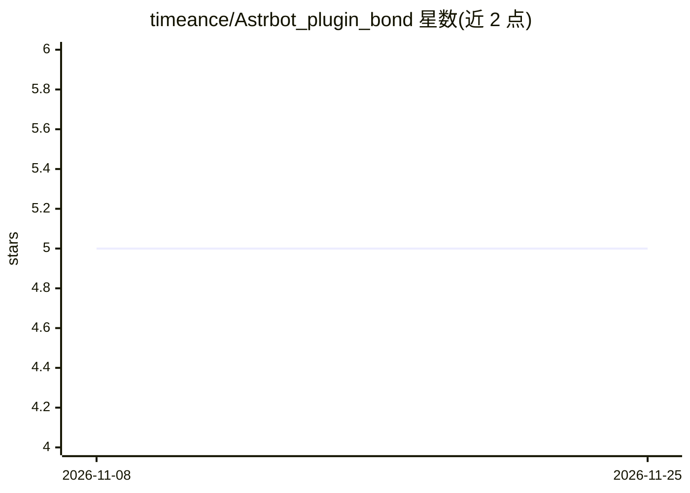

# timeance/Astrbot_plugin_bond

⭐ 5 · Python · AGPL-3.0 · 推送 2026-11-20 · [GitHub](https://github.com/timeance/Astrbot_plugin_bond) · 个人维护 · 中文 README

**为 AstrBot 群聊提供三维关系好感度与记忆管理**

Bond 是 AstrBot 的关系记忆插件，面向长期多人群聊。对每位成员记录熟悉度、亲近度、信任度三个维度，通过关系词典将数值状态转为自然语言称谓，供当前人格回复时参考。支持 LLM 自动评估互动、动态称谓生成、印象标签、图片排行榜，以及基于 AstrBot 原生页面的管理面板，可查看、调整、撤销关系与流水，按 Bot 账号与数据空间隔离存储。

## 筛选速览

| 维度 | 判定 | 备注 |
|---|---|---|
| AI 角色 | `ai-enhanced` | 去掉 AI 部分产品仍成立 |
| 许可风险 | `viral` | AGPL-3.0 |
| 部署形态 | `None` |  |
| 模型依赖 | — | README 未给出锁定关系 |
| 硬件要求 | — | 无带数字的原话,不猜 |
| 安装摩擦 | `low` | 无编译、无系统依赖或容器化 |
| 成熟度 | — | 结构信号不足 |

## 能力要点

- 三维关系（熟悉/亲近/信任）分别计算，125 主状态映射 76 个中文关系词条
- 可选 LLM 自动评估与动态称谓，固定词典路径不调用模型
- Web 管理面板：流水查询、临时调整、备份恢复、诊断记录
- 按 Bot 账号与 per_group/global 数据空间隔离存储

## 适用场景

- 为长期群聊机器人保留与每位成员的相处痕迹
- 让 bot 回复风格随关系亲疏变化
- 管理员查看和修正成员好感度与印象

## 场景标签

`聊天机器人` `Agent 记忆` · 领域:Agent 开发

## 证据(README 行号)

> L16: Bond 是面向 **长期多人群聊** 的关系记忆插件。它分别记录 Bot 对每位成员的熟悉度、亲近度与信任度，将三维状态转成自然语言描述，供当前人格在回复时参考。
> L104: Bond 通过 AstrBot 的标准请求钩子追加当前发言者的关系资料，不决定是否接话、回复对象或回复频率。休息、离场及模型选择继续由宿主或相应聊天插件负责。追加资料和保留系统提示的上下文改写可以共同使用；若其他插件绕过请求钩子

## 星数曲线

2026-11-08 5 → 2026-11-25 5（+0）

---
*卡片 v1 · prompt 1.4 · 生成 2026-11-21 · 置信度 high · 依据 README sha `d6a7bc03c331` · [字段定义](../../DATASET.md)*
