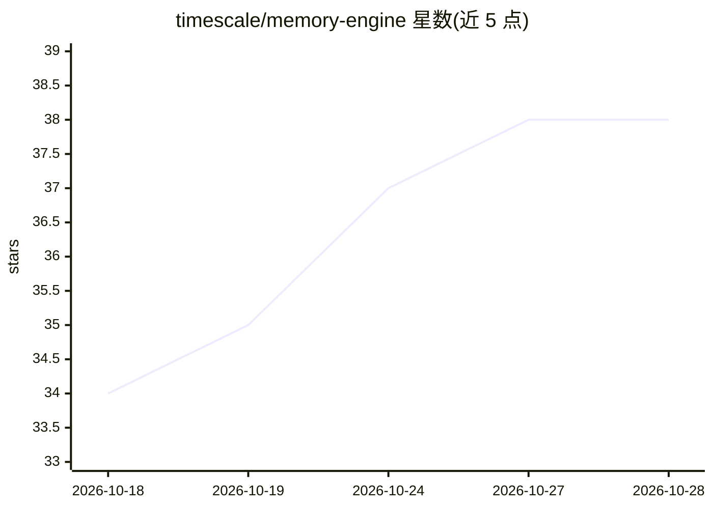

# timescale/memory-engine

⭐ 38 · TypeScript · Apache-2.0 · 推送 2026-10-27 · [GitHub](https://github.com/timescale/memory-engine) · [官网](https://memory.build) · 组织维护

**给 AI 编程代理的持久记忆层：基于 Postgres 与 MCP**

Memory Engine 为 AI 编程代理提供跨会话的持久记忆：以 MCP server 形式运行，代理通过 stdio 连接并获得 10 个工具来创建、搜索与管理记忆。数据存于 PostgreSQL，语义检索用 pgvector、BM25 关键词用 pg_textsearch、混合检索经 RRF 融合，另用 ltree 组织层级路径、JSONB+GIN 支持元数据谓词、tstzrange 支持时间查询。提供 curl 安装脚本、Homebrew 与 npm 三种 CLI 安装方式，支持 Docker Compose 自托管后端；也提供 Claude Code 插件（hooks、斜杠命令、MCP）。

## 筛选速览

| 维度 | 判定 | 备注 |
|---|---|---|
| AI 角色 | `ai-ecosystem` | LLM/agent 周边工具 |
| 许可风险 | `permissive` | Apache-2.0 |
| 部署形态 | `self-host` | docker 或自建部署 |
| 模型依赖 | — | README 未给出锁定关系 |
| 硬件要求 | — | 无带数字的原话,不猜 |
| 安装摩擦 | `low` | 无编译、无系统依赖或容器化 |
| 成熟度 | — | 结构信号不足 |

## 能力要点

- MCP server 形式为代理提供 10 个记忆工具
- pgvector 语义检索 + pg_textsearch BM25 + RRF 混合检索
- ltree 层级路径、JSONB 元数据谓词、时间范围查询
- Docker Compose 自托管后端与 Claude Code 插件

## 适用场景

- 让 AI 编程代理跨会话记住项目知识与决策
- 回填历史会话与 git 记录构建项目记忆库
- 团队自托管记忆后端并按 tree 做访问控制

## 场景标签

`Agent 记忆` · 领域:Agent 开发

## 证据(README 行号)

> L5: Memory Engine gives AI coding agents a persistent memory layer they can read from and write to via MCP. Memories are

## 星数曲线

2026-10-18 34 → 2026-10-28 38（+4）

---
*卡片 v1 · prompt 1.4 · 生成 2026-10-25 · 置信度 mid · 依据 README sha `3659a470c319` · [字段定义](../../DATASET.md)*
