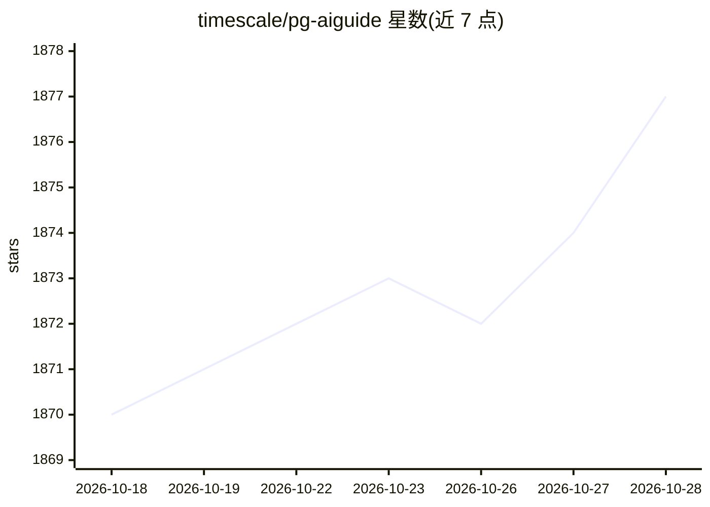

# timescale/pg-aiguide

⭐ 1,877 · Python · Apache-2.0 · 推送 2026-10-26 · [GitHub](https://github.com/timescale/pg-aiguide) · 组织维护

**给 AI 编码工具提供 PostgreSQL 知识的 MCP 服务器与技能包**

由 Timescale（TigerData）维护的 PostgreSQL 专业知识供给层：以公开 MCP 服务器形式提供对官方 PostgreSQL 手册（按版本）、TimescaleDB 与 PostGIS 文档的语义（向量）与 BM25 关键词统一搜索（search_docs 工具）；同时以技能（skills）形式提供面向 AI agent 的 schema 设计、索引、约束、性能调优等最佳实践（view_skill 工具）。可经 npx skills、Claude Code 插件市场或 MCP 配置接入 Claude Code、Cursor、Codex、Gemini CLI、VS Code 等 40+ agent。pgvector 文档标注 coming soon。

## 筛选速览

| 维度 | 判定 | 备注 |
|---|---|---|
| AI 角色 | `ai-ecosystem` | LLM/agent 周边工具 |
| 许可风险 | `permissive` | Apache-2.0 |
| 部署形态 | `library` | 以包/库形式分发 |
| 模型依赖 | locked-api |  |
| 硬件要求 | — | 无带数字的原话,不猜 |
| 安装摩擦 | `low` | 无编译、无系统依赖或容器化 |
| 成熟度 | — | 结构信号不足 |

## 能力要点

- search_docs 统一语义（向量）与 BM25 关键词搜索，覆盖 PostgreSQL/TimescaleDB/PostGIS 文档
- PostgreSQL 手册搜索按版本区分
- AI 优化技能覆盖 schema 设计、索引策略、约束、性能调优等主题
- 支持 Claude Code、Cursor、Codex、Gemini CLI、VS Code 等 40+ agent 接入

## 适用场景

- 让我常用的 AI 编码助手生成符合现代 PostgreSQL 特性的建表语句
- 给 agent 提供按版本检索官方 PostgreSQL 文档的能力
- 用现成技能约束 AI 生成的 schema 的索引与数据完整性设计

## 场景标签

`语义搜索` · 领域:知识与检索

## 证据(README 行号)

> L13: - **Agent Skills** via `npx skills` — works with Claude Code, Cursor, Codex, Gemini CLI, and 40+ other agents
> L14: - a **public MCP server** that can be used with any AI coding agent, or
> L225: - **`search_docs`**
> L233: - **`view_skill`**

## 星数曲线

2026-10-18 1,870 → 2026-10-28 1,877（+7）

---
*卡片 v1 · prompt 1.4 · 生成 2026-10-21 · 置信度 high · 依据 README sha `994fb9b06e69` · [字段定义](../../DATASET.md)*
