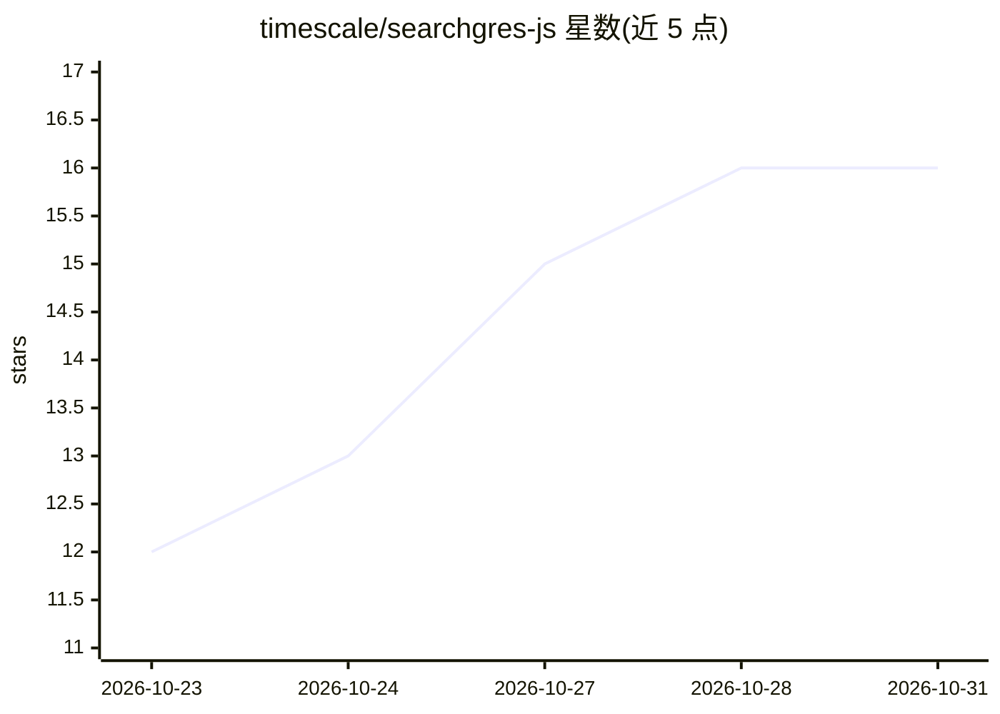

# timescale/searchgres-js

⭐ 16 · TypeScript · Apache-2.0 · 推送 2026-10-22 · [GitHub](https://github.com/timescale/searchgres-js) · 组织维护

**PostgreSQL 混合检索库：BM25+向量+RRF+结构化过滤**

开源 TypeScript 库，在用户自有 PostgreSQL 中实现混合检索：BM25 关键词搜索（pg_textsearch）、HNSW 向量搜索（pgvector）、RRF 融合排序，以及树路径、JSONB、时间范围与正则等可组合过滤。用户自带 postgres.js 连接与 AI SDK 嵌入模型，库负责管理搜索 schema、索引与嵌入队列（processEmbeddings / EmbeddingWorker）。不含用户/授权模型，不强制 RAG 框架。要求 PostgreSQL 18 与 pgvector、pg_textsearch、ltree 扩展，Node ≥22/Bun ≥1.4/Deno ≥2；仓库另附可选 CLI、MCP 工具与含本地 Ollama 的 Docker Compose 评估环境。

## 筛选速览

| 维度 | 判定 | 备注 |
|---|---|---|
| AI 角色 | `ai-ecosystem` | LLM/agent 周边工具 |
| 许可风险 | `permissive` | Apache-2.0 |
| 部署形态 | `self-host` | docker 或自建部署 |
| 模型依赖 | local-ok | 支持本地模型 |
| 硬件要求 | — | 无带数字的原话,不猜 |
| 安装摩擦 | `low` | 无编译、无系统依赖或容器化 |
| 成熟度 | — | 结构信号不足 |

## 能力要点

- BM25、HNSW 向量与 RRF 混合检索，模式由参数推断
- 树路径/JSONB/时间/正则可组合过滤，支持过滤强制注入做访问边界
- 索引为普通 PostgreSQL schema：统一事务、备份复制与直接 SQL 访问
- 新写入记录立即可被 BM25 与过滤检索，嵌入队列支持后台 Worker

## 适用场景

- 在自有 PostgreSQL 上构建应用搜索或托管搜索 API
- RAG 场景中自管检索层，保留自有 chunking 与生成流程
- 从现有表经代码/SQL/触发器构建索引流水线
- 无 API key 本地评估（Docker Compose + Ollama）

## 场景标签

`语义搜索` · 领域:知识与检索

## 证据(README 行号)

> L9: searchgres.js is an open-source TypeScript library that combines BM25 keyword
> L105: - RAG retrieval with your own chunking and generation stages;

## 星数曲线

2026-10-23 12 → 2026-10-31 16（+4）

---
*卡片 v1 · prompt 1.4 · 生成 2026-10-30 · 置信度 high · 依据 README sha `c0314a9db38a` · [字段定义](../../DATASET.md)*
