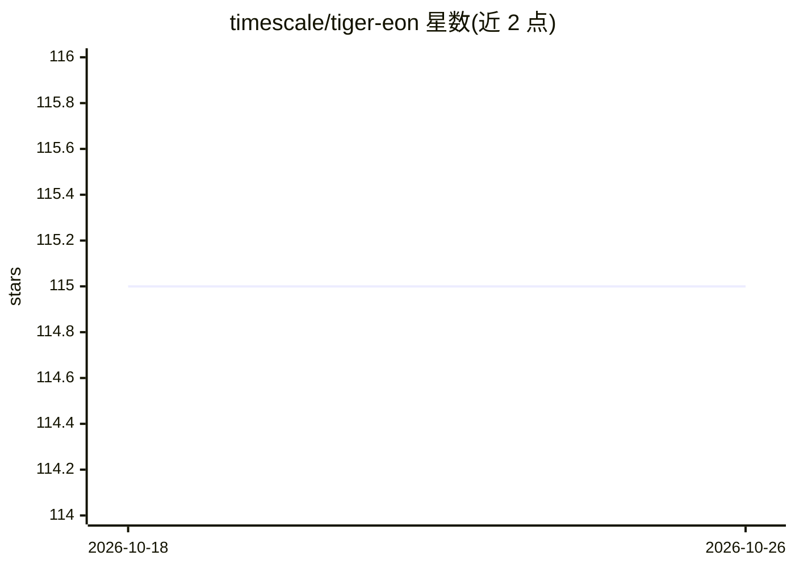

# timescale/tiger-eon

⭐ 115 · TypeScript · Apache-2.0 · 推送 2026-10-01 · [GitHub](https://github.com/timescale/tiger-eon) · 组织维护

**面向企业内部知识的 LLM Slack 问答机器人**

由 Timescale 维护的开源 Slack 机器人：在 Slack 中@机器人提问，即可从 Slack 公开对话历史、GitHub PR/issue 与 Linear 任务中检索并生成回答。基于 tiger-agents-for-work 库构建，Agent 与 MCP 服务无状态运行在用户自有基础设施，状态存储于 Tiger Postgres 服务或任意带 TimescaleDB 的自托管 Postgres。使用 Anthropic API 作为 LLM，需要配置 Slack 应用、GitHub token；Docker Compose 启动，可选导入 Slack 历史数据导出；文档与 Salesforce 集成标注为即将推出。

## 筛选速览

| 维度 | 判定 | 备注 |
|---|---|---|
| AI 角色 | `ai-native` | 本体是模型或模型工具 |
| 许可风险 | `permissive` | Apache-2.0 |
| 部署形态 | `self-host` | docker 或自建部署 |
| 模型依赖 | — | README 未给出锁定关系 |
| 硬件要求 | — | 无带数字的原话,不猜 |
| 安装摩擦 | `low` | 无编译、无系统依赖或容器化 |
| 成熟度 | — | 结构信号不足 |

## 能力要点

- Slack 中检索公司公开对话历史生成回答
- GitHub 与 Linear 集成（可选），总结 PR、issue 与任务进展
- Agent 与 MCP 服务无状态运行于用户自有基础设施
- 状态存储用 Tiger Postgres 或自托管 TimescaleDB Postgres，支持导入 Slack 历史数据导出

## 适用场景

- 在 Slack 里直接问团队上周做了什么、什么阻塞了发布
- 汇总 GitHub PR 与 Linear 任务进展
- 让新成员快速检索散落在 Slack/ GitHub 中的内部知识

## 场景标签

`文档问答` `聊天机器人` · 领域:对话与助手

## 证据(README 行号)

> L7: Ask a question in Slack:
> L25: - **Slack** — Ask questions, and Eon searches your company's public conversations and history to find the answers

## 星数曲线

2026-10-18 115 → 2026-10-26 115（+0）

---
*卡片 v1 · prompt 1.4 · 生成 2026-10-23 · 置信度 high · 依据 README sha `b8b848cb8a80` · [字段定义](../../DATASET.md)*
