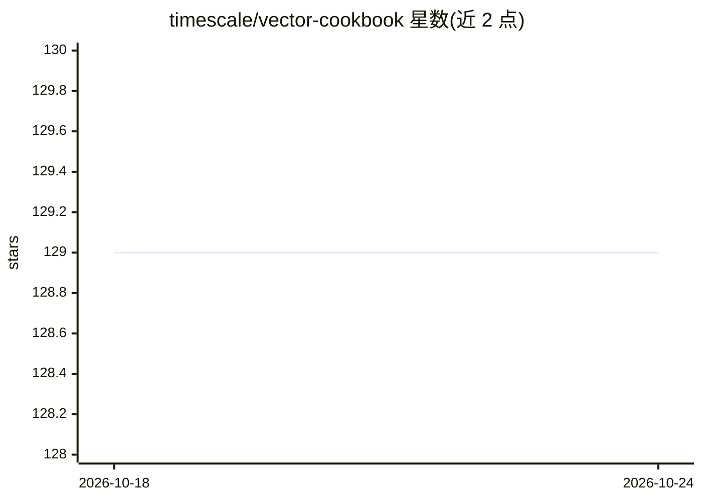

# timescale/vector-cookbook

⭐ 129 · Jupyter Notebook · 推送 2026-10-01 · [GitHub](https://github.com/timescale/vector-cookbook) · [官网](https://www.timescale.com/ai) · 组织维护

**用 PostgreSQL 与 Timescale Vector 构建 LLM 应用的示例代码集**

Timescale 维护的食谱（cookbook）仓库：汇集基于 PostgreSQL、pgvector 与 Timescale Vector 构建 LLM 应用的示例代码与入门套件。Timescale Vector 在 pgvector 基础上提供搜索加速、召回率与时间过滤改进。仓库收录 LangChain/LlamaIndex 集成与 Python 客户端库等资源链接，附一个 LlamaIndex+Streamlit 的示例应用（与任意仓库 git 提交历史对话），并引导注册 90 天免费云 PostgreSQL。需自行配置 Python/pyenv/Jupyter 环境。

## 筛选速览

| 维度 | 判定 | 备注 |
|---|---|---|
| AI 角色 | `ai-knowledge` | 知识聚合/清单类 |
| 许可风险 | `none` | — |
| 部署形态 | `None` |  |
| 模型依赖 | — | README 未给出锁定关系 |
| 硬件要求 | — | 无带数字的原话,不猜 |
| 安装摩擦 | `low` | 无编译、无系统依赖或容器化 |
| 成熟度 | — | 结构信号不足 |

## 能力要点

- 基于 PostgreSQL + Timescale Vector 的 LLM 应用食谱集合
- 收录 LangChain 与 LlamaIndex 集成资源与 Python 客户端库
- TSV Time Machine 示例：与任意 git 仓库提交历史对话（LlamaIndex + Streamlit）
- 包含 pgvector 教程（ivfflat 索引、OpenAI embeddings 存取）

## 适用场景

- 参考示例学习用 PostgreSQL/pgvector 做向量检索与 LLM 应用
- 获取 Timescale Vector + LangChain/LlamaIndex 的入门模板
- 动手复现带时间过滤的语义搜索场景

## 场景标签

 · 领域:向量数据库/LLM 应用开发

## 证据(README 行号)

> L2: A collection of recipes and sample application starter kits to build with LLMs using PostgreSQL and Timescale Vector
> L9: Timescale Vector enables you to power AI applications using PostgreSQL to store vector, relational and time-series d

## 星数曲线

2026-10-18 129 → 2026-10-24 129（+0）

---
*卡片 v1 · prompt 1.4 · 生成 2026-10-22 · 置信度 high · 依据 README sha `e59e4dc9ea51` · [字段定义](../../DATASET.md)*
