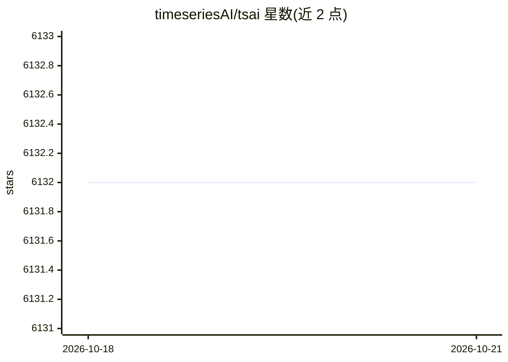

# timeseriesAI/tsai

⭐ 6,132 · Jupyter Notebook · Apache-2.0 · 推送 2026-07-23 · [GitHub](https://github.com/timeseriesAI/tsai) · [官网](https://timeseriesai.github.io/tsai/) · 组织维护

**面向时间序列任务的 PyTorch/fastai 深度学习库**

tsai 是构建在 PyTorch 与 fastai 之上的开源深度学习包，覆盖时间序列分类、回归、预测、填补等任务。内置 60 余种模型（LSTM、InceptionTime、Rocket、MiniRocket、PatchTST、TST 等），支持单变量/多变量输入输出的单步与多步预测，提供 sklearn 风格 pipeline 变换与 walk-forward 交叉验证；数据可通过内置接口下载 200 余个数据集。要求 Python 3.10+，经 pip 安装；ROCKET 类模型需另装 sktime。由 timeseriesAI 团队维护，并提供企业支持与咨询服务联系方式。

## 筛选速览

| 维度 | 判定 | 备注 |
|---|---|---|
| AI 角色 | `ai-native` | 本体是模型或模型工具 |
| 许可风险 | `permissive` | Apache-2.0 |
| 部署形态 | `library` | 以包/库形式分发 |
| 模型依赖 | — | README 未给出锁定关系 |
| 硬件要求 | — | 无带数字的原话,不猜 |
| 安装摩擦 | `low` | 无编译、无系统依赖或容器化 |
| 成熟度 | `idea` | |

## 能力要点

- 内置 60+ 时间序列模型（PatchTST、InceptionTime、MiniRocket、TST 等）
- 支持分类/回归/预测/填补，单变量与多变量、单步与多步预测
- 内置数据集下载（128 单变量分类 + 30 多变量分类 + 15 回归 + 62 预测等）
- 提供训练/推理示例与 Google Colab 教程 notebook

## 适用场景

- 训练时间序列分类、回归或预测模型
- 复现 PatchTST、InceptionTime 等时间序列模型
- 学习时间序列深度学习方法（教程 notebook）

## 场景标签

 · 领域:机器学习/时间序列

## 证据(README 行号)

> L13: `tsai` is an open-source deep learning package built on top of Pytorch &
> L14: fastai focused on state-of-the-art techniques for time series tasks like
> L15: classification, regression, forecasting, imputation…

## 星数曲线

2026-10-18 6,132 → 2026-10-21 6,132（+0）

---
*卡片 v1 · prompt 1.4 · 生成 2026-10-20 · 置信度 high · 依据 README sha `2e9893bf4ae6` · [字段定义](../../DATASET.md)*
