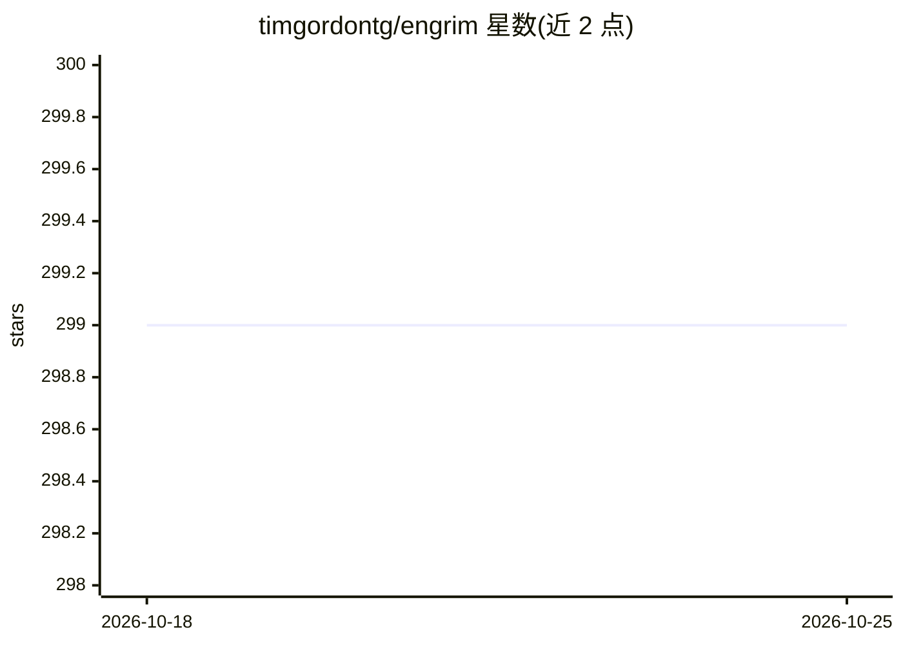

# timgordontg/engrim

⭐ 300 · Python · MIT · 推送 2026-09-26 · [GitHub](https://github.com/timgordontg/engrim) · [官网](https://engrim.dev) · 个人维护

**跨 AI 编码代理的本地 SQLite 情景记忆引擎**

面向自主 AI 编码代理与重度开发者的跨模型情景记忆层：将架构决策、用户约束与项目状态存入单个本地 SQLite 文件（~/.engrim/memory.db），启动时注入约 4,000 字符的记忆包，替代整段会话记录重放。通过 `engrim setup` 自动检测并接入 Google Antigravity、Claude Code、Cursor、Codex CLI、GitHub Copilot CLI、OpenCode、Windsurf 等环境，经生命周期钩子与 MCP 记录/检索（BM25+model2vec 混合检索）。本地存储、无遥测，提供 `engrim doctor` 诊断与路径自修复。

## 筛选速览

| 维度 | 判定 | 备注 |
|---|---|---|
| AI 角色 | `ai-ecosystem` | LLM/agent 周边工具 |
| 许可风险 | `permissive` | MIT |
| 部署形态 | `library` | 以包/库形式分发 |
| 模型依赖 | — | README 未给出锁定关系 |
| 硬件要求 | — | 无带数字的原话,不猜 |
| 安装摩擦 | `low` | 无编译、无系统依赖或容器化 |
| 成熟度 | — | 结构信号不足 |

## 能力要点

- 单个本地 SQLite 文件跨 6+ 个代理环境共享项目记忆
- 启动注入约 4,000 字符记忆包，/clear 后可无损续接
- 生命周期钩子 + MCP 记录决策，混合 BM25+向量检索（约 30ms）
- `engrim setup` 自动检测已装环境并配置，`engrim doctor --fix` 自修复

## 适用场景

- 在同一代码库上切换 Claude Code / Cursor / Codex 等工具时保留架构决策
- 清除会话上下文后快速恢复项目状态与约束
- 避免每轮重发长上下文以控制 token 成本

## 场景标签

`Agent 记忆` · 领域:Agent 开发

## 证据(README 行号)

> L13: A local-first, project-scoped SQLite memory engine that allows developers to freely switch between models and envir
> L21: It solves the **"200,000-token context window trap"** (where coding models suffer from severe attention dilution, c
> L43: 2. **Capture**: As the agent works, it records architectural decisions via MCP (`engrim_add`) or lifecycle hooks au

## 星数曲线

2026-10-18 299 → 2026-10-25 299（+0）

---
*卡片 v1 · prompt 1.4 · 生成 2026-10-21 · 置信度 high · 依据 README sha `ef101f151217` · [字段定义](../../DATASET.md)*
