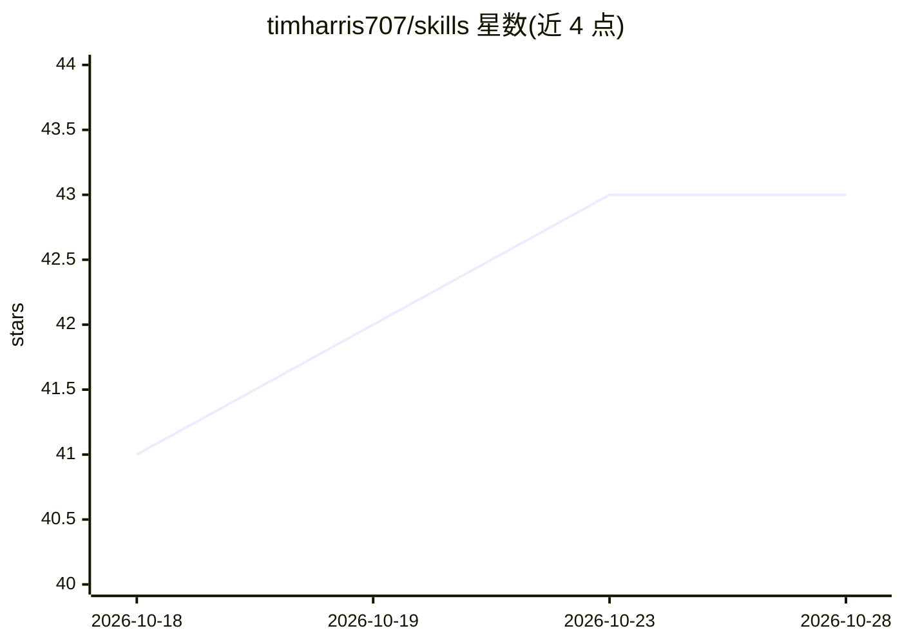

# timharris707/skills

⭐ 43 · Python · MIT · 推送 2026-10-23 · [GitHub](https://github.com/timharris707/skills) · [官网](https://timharris707.github.io/skills/) · 个人维护

**给非工程师的 23 个 agent 技能包：以编排会话带团队交付**

以 SKILL.md 纯 markdown 剧本形式提供的 23 个 agent 技能，装进 Claude Code 或 Codex（Astra 工作流适配版）等运行时使用。核心是 team-workflow 包：一次 setup 面谈把纪律绑定到仓库，之后一个编排会话充当'首席开发者'，调度 grilling 追问、advisory-board 多模型评审、handoff、to-tickets、adversarial-review 等技能，覆盖规划、研究、原型、交接与并行协调。README 自述由团队负责人（非写代码者）视角改写，供不愿读代码的人主导交付。

## 筛选速览

| 维度 | 判定 | 备注 |
|---|---|---|
| AI 角色 | `ai-ecosystem` | LLM/agent 周边工具 |
| 许可风险 | `permissive` | MIT |
| 部署形态 | `None` |  |
| 模型依赖 | — | README 未给出锁定关系 |
| 硬件要求 | — | 无带数字的原话,不猜 |
| 安装摩擦 | `low` | 无编译、无系统依赖或容器化 |
| 成熟度 | — | 结构信号不足 |

## 能力要点

- team-workflow 包：单一编排会话调度其余技能，覆盖计划到交付全流程
- advisory-board：Claude/Codex/Gemini/Grok 独立评审同一决策后合议，输出 verdict.json
- 每技能为 SKILL.md 剧本，任何能读 markdown 的运行时可用，附 Codex 适配器
- 两个发行版：Claude Code 插件包与适配 Astra 的 Codex 桌面版

## 适用场景

- 不写代码的创始人/产品负责人通过对话主导 agent 团队完成交付
- 关键架构或发布决策前跑多模型独立评审并留 CI 可读结论
- 跨会话交接与并行任务道协调，避免上下文丢失和会话冲突

## 场景标签

`多智能体` `提示工程` · 领域:Agent 开发

## 证据(README 行号)

> L7: Each skill is a `SKILL.md`, a plain-markdown playbook the agent reads on its own: every workflow I used to re-explai
> L41: One repository, two editions: the original Claude Code packages
> L104: - **The team-workflow pack**, first. Install it, run setup once, then open one session and say "orchestration mode

## 星数曲线

2026-10-18 41 → 2026-10-28 43（+2）

---
*卡片 v1 · prompt 1.4 · 生成 2026-10-25 · 置信度 high · 依据 README sha `2616a0d6fe7a` · [字段定义](../../DATASET.md)*
