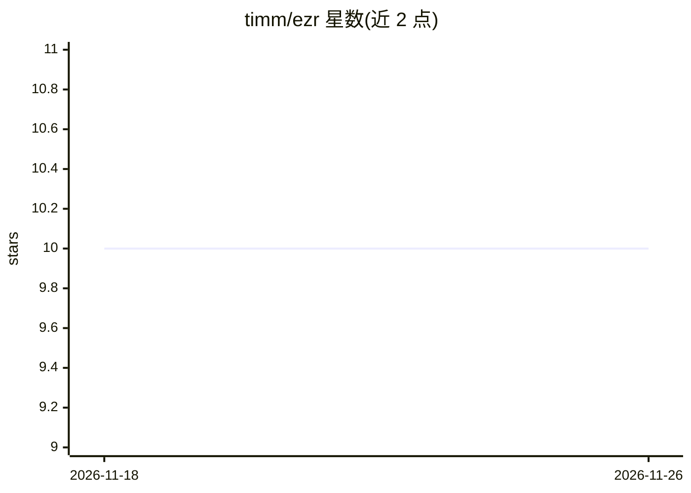

# timm/ezr

⭐ 10 · Python · 推送 2026-10-25 · [GitHub](https://github.com/timm/ezr) · [官网](https://timm.github.io/ezr/) · 个人维护

**给优化研究者用的半监督多目标优化解释工具包**

ezr 是一个约 600 行、零运行时依赖的 Python 库，做可解释的多目标优化：用主动学习标注约 50 行有信息量的数据，生长小型回归树并对其余行排序；另含朴素贝叶斯分类、聚类（kmeans/kmeans++）、模拟退火与局部搜索等经典优化器，以及统计检验工具。输入为 CSV，表头用大小写和 +/!/- 等符号定义列角色。两个文件、无包结构、无测试框架，`test_*` 函数兼作演示与帮助条目。源自论文《Can AI be Easy?》的教学型工具。

## 筛选速览

| 维度 | 判定 | 备注 |
|---|---|---|
| AI 角色 | `ai-native` | 本体是模型或模型工具 |
| 许可风险 | `none` | — |
| 部署形态 | `library` | 以包/库形式分发 |
| 模型依赖 | — | README 未给出锁定关系 |
| 硬件要求 | — | 无带数字的原话,不猜 |
| 安装摩擦 | `low` | 无编译、无系统依赖或容器化 |
| 成熟度 | — | 结构信号不足 |

## 能力要点

- 主动学习标注约 50 行后用回归树解释并排序全部数据
- 零运行时依赖，单文件库加演示文件共约 600 行
- 提供 CLI 演示（--tree/--klass/--optimize 等）与 Python 库两种用法
- 内置统计检验（cliffs/ks/cohen/wins）判断差异是否显著

## 适用场景

- 标注成本高的多目标优化任务中寻找最优解并解释结果
- 教学演示主动学习、聚类与贝叶斯分类原理
- 对分类器对比结果做显著性统计检验

## 场景标签

`科研工具` `教程课程` · 领域:学习与行业

## 证据(README 行号)

> L25: **ezr** is an experiment in "how easy is AI?" (see the paper
> L29: active learner labels ~50 informative rows, grows a small
> L30: regression tree from them, and uses that tree to rank

## 星数曲线

2026-11-18 10 → 2026-11-26 10（+0）

---
*卡片 v1 · prompt 1.4 · 生成 2026-11-19 · 置信度 high · 依据 README sha `e8eace3d29eb` · [字段定义](../../DATASET.md)*
