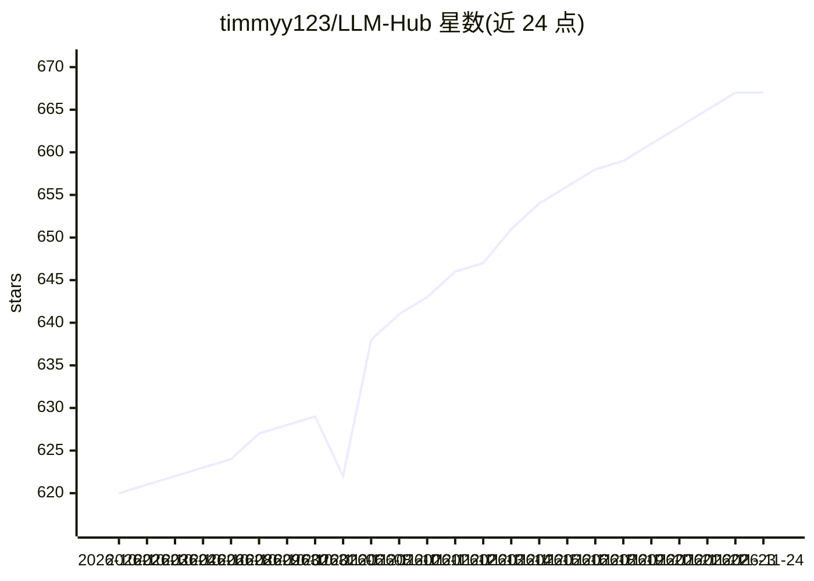

# timmyy123/LLM-Hub

⭐ 667 · C · NOASSERTION · 推送 2026-11-22 · [GitHub](https://github.com/timmyy123/LLM-Hub) · [官网](https://llm-hub.app) · 个人维护

**本地端运行 LLM 对话与图像/视频/音乐生成的开源移动与桌面应用**

面向 Android/iOS 及 Windows/macOS/Linux 桌面的本地推理应用：提供多轮对话（RAG 记忆、网页搜索、TTS）、设备 Agent（函数调用、MCP 工具、Termux 命令生成）、Stable Diffusion 图像生成、LTX-Video/Stable Video Diffusion 视频生成、Magenta Realtime 2/SoundGen 音乐生成、Whisper 转录、语音克隆与媒体搜索等工具套件。全部推理在设备端完成，声明无账号、无云端、零数据收集。移动端针对 CPU/GPU/NPU 加速，支持导入 .gguf、.qnn、.mnn 等多种模型格式，并可从 HuggingFace 直接下载模型。

## 筛选速览

| 维度 | 判定 | 备注 |
|---|---|---|
| AI 角色 | `ai-native` | 本体是模型或模型工具 |
| 许可风险 | `none` | NOASSERTION |
| 部署形态 | `None` |  |
| 模型依赖 | local-ok | 支持本地模型 |
| 硬件要求 | — | 无带数字的原话,不猜 |
| 安装摩擦 | `medium` | 含编译或系统依赖之一 |
| 成熟度 | — | 结构信号不足 |

## 能力要点

- 100% 设备端推理：对话、图像、视频、音乐、转录均本地运行
- AI Agent 支持设备函数调用、MCP 外部工具接入与 Termux 命令执行
- 支持导入 .task/.litertlm/.qnn/.mnn/.gguf 多格式模型并从 HuggingFace 下载
- 桌面版对外提供 OpenAI 与 Anthropic 兼容 API

## 适用场景

- 在手机上离线运行本地大模型进行私密对话
- 本地生成图像、视频与音乐素材
- 在 Android 上通过 Termux 用本地模型驱动 Codex/Claude Code 编码
- 离线翻译、转录与媒体搜索

## 场景标签

`聊天机器人` `图像生成` `视频生成` `语音合成` · 领域:对话与助手

## 证据(README 行号)

> L3: **LLM Hub** is an open-source mobile app for on-device LLM chat, image generation, video generation, and music gener
> L49: |**💬 Chat**|Multi-turn conversations with RAG memory, web search, TTS auto-readout, and multimodal input|
> L103: - **100% on-device processing** - no internet required for inference

## 星数曲线

2026-10-22 620 → 2026-11-24 667（+47）

---
*卡片 v1 · prompt 1.4 · 生成 2026-11-24 · 置信度 high · 依据 README sha `3653b355dfce` · [字段定义](../../DATASET.md)*
