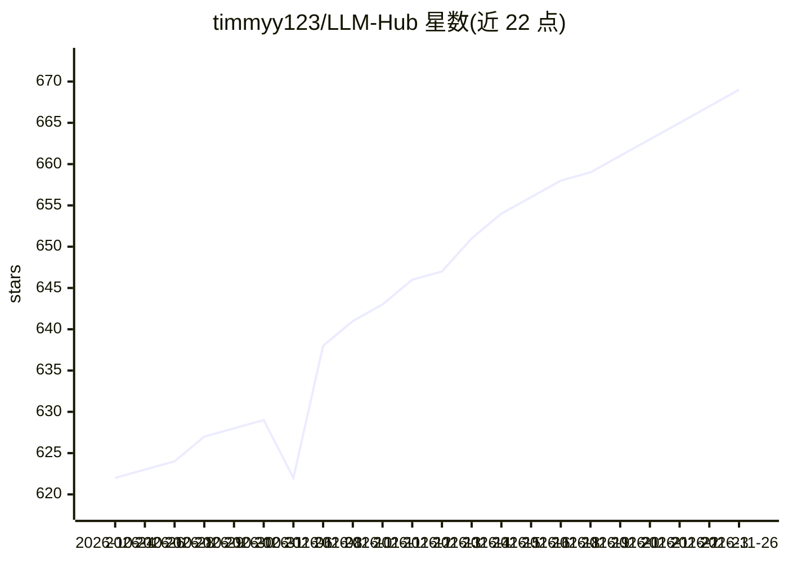

# timmyy123/LLM-Hub

⭐ 669 · Swift · NOASSERTION · 推送 2026-11-25 · [GitHub](https://github.com/timmyy123/LLM-Hub) · [官网](https://llm-hub.app) · 个人维护

**跨平台本地 LLM 应用：手机与桌面端离线聊天与多媒体生成**

开源应用，在 Android/iOS 及 Windows/macOS/Linux（Desktop 版）上运行本地模型，功能包括多轮聊天（RAG 记忆、网页搜索、TTS）、Stable Diffusion 文生图、LTX-Video 文生视频、Magenta Realtime 2 音乐生成、语音克隆、翻译、转录与钓鱼检测等。通过 LiteRT-LM、MediaPipe、llama.cpp（GGUF）、ONNX Runtime 等引擎在 CPU/GPU/NPU 上推理，全部在设备端处理、不收集数据。移动端 Flash streaming 支持运行超出内存的 MoE 模型。

## 筛选速览

| 维度 | 判定 | 备注 |
|---|---|---|
| AI 角色 | `ai-native` | 本体是模型或模型工具 |
| 许可风险 | `none` | NOASSERTION |
| 部署形态 | `None` |  |
| 模型依赖 | local-ok | 支持本地模型 |
| 硬件要求 | — | 无带数字的原话,不猜 |
| 安装摩擦 | `medium` | 含编译或系统依赖之一 |
| 成熟度 | — | 结构信号不足 |

## 能力要点

- 100% 设备端推理，无需账号与云端
- 支持聊天/文生图/文生视频/音乐生成/语音克隆等多类生成任务
- Flash streaming 运行超出设备内存的 MoE GGUF 模型
- 在 Termux 中以本地模型运行 Codex 与 Claude Code

## 适用场景

- 在手机上离线使用本地 LLM 聊天与写作辅助
- 无网络环境下生成图片、视频与音乐
- 用设备端 Agent 执行日历、短信等设备操作与 Termux 命令

## 场景标签

`聊天机器人` `图像生成` `视频生成` `语音合成` · 领域:对话与助手

## 证据(README 行号)

> L5: **LLM Hub** is an open-source app for on-device LLM chat, image generation, video generation, and music generation, 
> L51: |**Chat**|Multi-turn conversations with RAG memory, web search, TTS auto-readout, and multimodal input|

## 星数曲线

2026-10-24 622 → 2026-11-26 669（+47）

---
*卡片 v1 · prompt 1.4 · 生成 2026-11-26 · 置信度 high · 依据 README sha `14584a737da2` · [字段定义](../../DATASET.md)*
