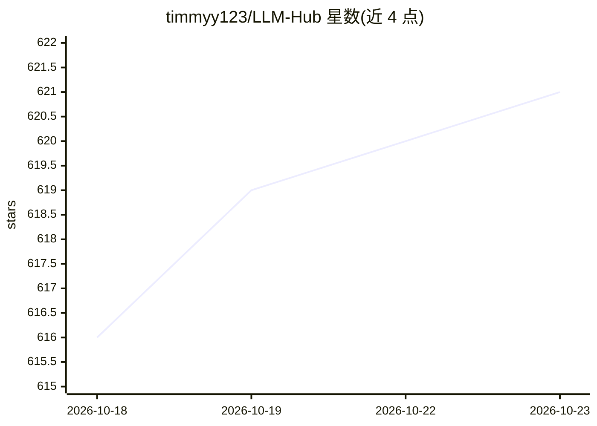

# timmyy123/LLM-Hub

⭐ 621 · C · NOASSERTION · 推送 2026-10-22 · [GitHub](https://github.com/timmyy123/LLM-Hub) · [官网](https://llm-hub.app) · 个人维护

**手机端本地大模型应用：聊天、图像/视频/音乐生成与语音工具**

面向 Android/iOS 的开源移动应用，在设备本地运行 LLM 聊天（RAG 记忆、联网搜索、多模态输入）、Stable Diffusion 图像生成、LTX-Video 视频生成、Magenta/SoundGen 音乐生成、Whisper 语音转写、TTS 与语音克隆、翻译、诈骗检测与媒体语义搜索等功能。Android 端 Vibe Coder 可通过 Termux 接入 Codex 应用服务器，由本地模型驱动代码代理；推理支持 CPU/GPU/NPU 加速，可导入 .task/.gguf 等格式模型并从 HuggingFace 下载。通过应用商店分发或源码构建。

## 筛选速览

| 维度 | 判定 | 备注 |
|---|---|---|
| AI 角色 | `ai-native` | 本体是模型或模型工具 |
| 许可风险 | `none` | NOASSERTION |
| 部署形态 | `None` |  |
| 模型依赖 | — | README 未给出锁定关系 |
| 硬件要求 | — | 无带数字的原话,不猜 |
| 安装摩擦 | `medium` | 含编译或系统依赖之一 |
| 成熟度 | — | 结构信号不足 |

## 能力要点

- 多模态生成套件：聊天、图像、视频、音乐生成均在设备本地运行
- AI Agent 支持设备函数调用、MCP 工具与 Termux 命令生成（含执行前编辑与错误自纠）
- Android Vibe Coder 经 Termux 接入 Codex，用本地模型驱动代码代理，无需 OpenAI 登录
- TTS 三引擎（Kokoro/Supertonic 3/Pocket TTS）含本地语音克隆

## 适用场景

- 在手机上离线运行大模型聊天与图像、视频、音乐生成
- 不联网、数据不出设备地使用语音转写、翻译与语音克隆
- 让 AI 代理执行手机设备操作或生成并运行 Termux 命令
- 用自然语言搜索相册照片/视频并定位视频中的具体时刻

## 场景标签

 · 领域:端侧 AI 应用

## 证据(README 行号)

> L3: **LLM Hub** is an open-source mobile app for on-device LLM chat, image generation, video generation, and music gener
> L80: - **100% on-device processing** - no internet required for inference
> L31: |**💻 Vibe Coder**|**[NEW]** Build apps with live HTML/JS preview; Android also integrates Codex through Termux usin

## 星数曲线

2026-10-18 616 → 2026-10-23 621（+5）

---
*卡片 v1 · prompt 1.4 · 生成 2026-10-21 · 置信度 high · 依据 README sha `bddedb81bead` · [字段定义](../../DATASET.md)*
