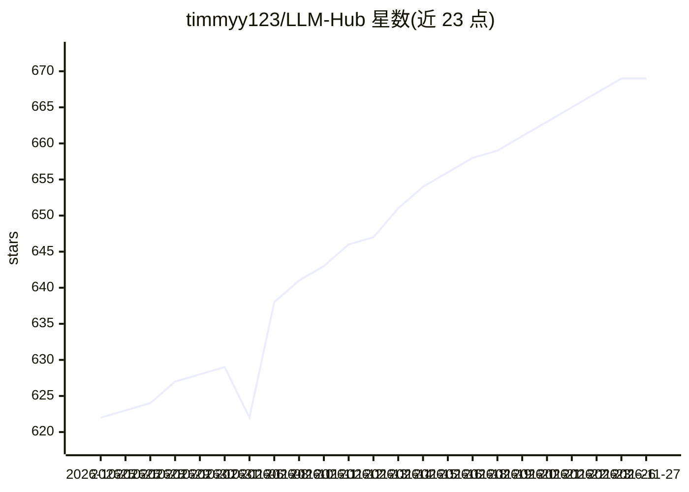

# timmyy123/LLM-Hub

⭐ 669 · Swift · NOASSERTION · 推送 2026-11-26 · [GitHub](https://github.com/timmyy123/LLM-Hub) · [官网](https://llm-hub.app) · 个人维护

**手机/桌面上本地运行的 LLM 聊天与图像视频音乐生成应用**

开源端侧应用，覆盖 Android、iOS 及 Windows/macOS/Linux 桌面版，提供本地 LLM 多轮对话、AI Agent（函数调用、MCP 工具、Termux 命令生成）、Stable Diffusion 图像生成、LTX-Video 视频生成、Stable Audio/Magenta Realtime 音乐生成、离线语音识别与 TTS 等。推理全部在设备上完成，通过 LiteRT-LM、llama.cpp、ONNX Runtime 等引擎及 Hexagon NPU/Vulkan/Metal 加速，Flash streaming 可在内存不足时运行更大的 MoE 模型。无需账号与云端，面向希望本地私密使用 AI 的移动与桌面用户。

## 筛选速览

| 维度 | 判定 | 备注 |
|---|---|---|
| AI 角色 | `ai-native` | 本体是模型或模型工具 |
| 许可风险 | `none` | NOASSERTION |
| 部署形态 | `None` |  |
| 模型依赖 | local-ok | 支持本地模型 |
| 硬件要求 | — | 无带数字的原话,不猜 |
| 安装摩擦 | `medium` | 含编译或系统依赖之一 |
| 成熟度 | — | 结构信号不足 |

## 能力要点

- 端侧运行聊天、图像/视频/音乐生成、语音识别与 TTS，无需联网
- AI Agent 支持函数调用、MCP 工具与 Termux 命令生成及错误自动修正
- Flash streaming 使超出设备内存的 MoE GGUF 模型可运行（Gemma 4 26B-A4B 等）
- 自维护 patched llama.cpp，覆盖 NPU/GPU/CPU 各后端

## 适用场景

- 在手机上无网络环境私密使用本地模型聊天与生成媒体
- 通过 Termux 在本地模型上运行 Codex 或 Claude Code 编程
- 离线转录语音、翻译文本图像与克隆声音
- 在 Snapdragon NPU 设备上快速生成短视频片段

## 场景标签

`聊天机器人` `图像生成` `视频生成` `语音识别` · 领域:对话与助手

## 证据(README 行号)

> L5: **LLM Hub** is an open-source app for on-device LLM chat, image generation, video generation, and music generation, 
> L110: - **100% on-device processing** - no internet required for inference
> L116: - GPU and NPU acceleration (Snapdragon Hexagon NPU, LiteRT GPU, OpenCL and Vulkan) with automatic CPU fallback

## 星数曲线

2026-10-25 622 → 2026-11-27 669（+47）

---
*卡片 v1 · prompt 1.4 · 生成 2026-11-27 · 置信度 high · 依据 README sha `c9696d39bc8f` · [字段定义](../../DATASET.md)*
