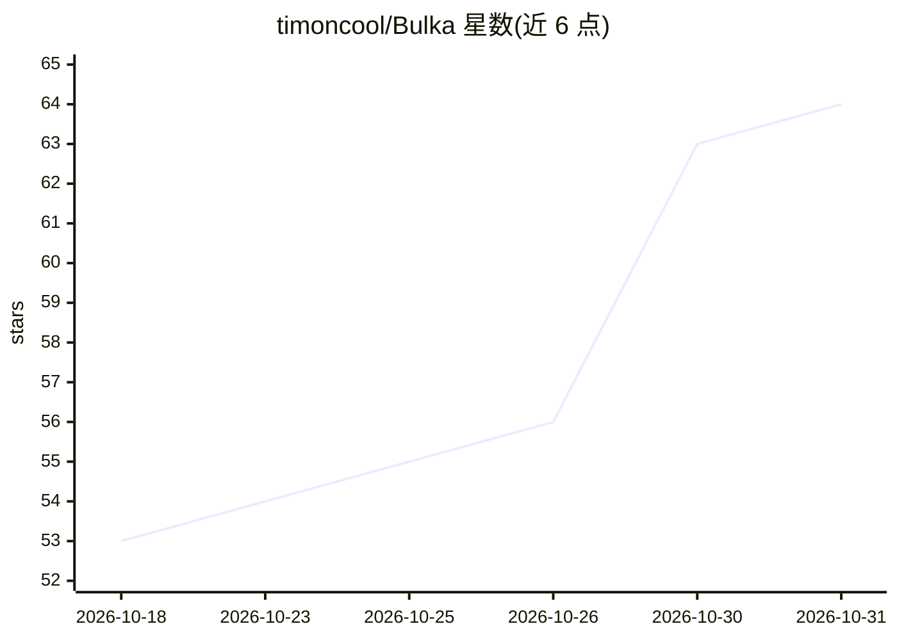

# timoncool/Bulka

⭐ 64 · JavaScript · AGPL-3.0 · 推送 2026-10-30 · [GitHub](https://github.com/timoncool/Bulka) · [官网](https://bulka.app) · 个人维护 · 中文 README

**俄语向浏览器音乐代码编辑器：内置 AI 助手实时生成与修改音乐代码**

Strudel 的俄语分支，浏览器内通过写代码实时合成音乐的编辑器（Web Audio API），面向音乐人、程序员、VJ 与编程初学者。内置 AI 助手可按自然语言生成/编辑音乐代码、查文档并解释；免费模式经 OVHcloud AI Endpoints 使用开源权重模型（限 2 请求/分钟/IP），也可接入自有 OpenAI/Anthropic/Gemini 密钥或 OpenRouter。附 WAV 录制/导出、Hydra 可视化、Windows/Linux/macOS 桌面版（桌面版内建 MCP 服务器供 Claude Desktop/Cursor 等外部控制）。

## 筛选速览

| 维度 | 判定 | 备注 |
|---|---|---|
| AI 角色 | `ai-enhanced` | 去掉 AI 部分产品仍成立 |
| 许可风险 | `viral` | AGPL-3.0 |
| 部署形态 | `desktop` | 安装包/桌面程序 |
| 模型依赖 | — | README 未给出锁定关系 |
| 硬件要求 | — | 无带数字的原话,不猜 |
| 安装摩擦 | `low` | 无编译、无系统依赖或容器化 |
| 成熟度 | — | 结构信号不足 |

## 能力要点

- AI 助手生成/编辑音乐代码、检索内置文档，支持 GPT/Claude/Gemini 与免费无密钥模式
- 浏览器内实时播放，Web Audio API，内置大量采样与合成器
- 桌面版内建 MCP 服务器，可由 Claude Desktop/ChatGPT/Cursor 外部控制
- 一键录制 WAV、Hydra 同步 live 可视化

## 适用场景

- 在浏览器里写代码实时做音乐/现场演出
- 让 AI 助手按描述生成鼓点、贝斯等音乐代码
- algorave 演出或 VJ 场景下音画同步创作

## 场景标签

`代码生成` · 领域:编码与开发

## 证据(README 行号)

> L16: **Bulka** — это браузерный редактор для создания музыки кодом в реальном времени. Открываешь сайт, пишешь пару стро
> L18: Это русскоязычный форк Strudel с встроенным AI-агентом, который помогает писать код, объясняет как что работает и и
> L29: Встроенный ассистент на базе GPT-5.2, Claude Opus 4.5 или Gemini 3 Pro. Пишешь "сделай техно-бит" — получаешь готов

## 星数曲线

2026-10-18 53 → 2026-10-31 64（+11）

---
*卡片 v1 · prompt 1.4 · 生成 2026-10-24 · 置信度 mid · 依据 README sha `0e151164f475` · [字段定义](../../DATASET.md)*
