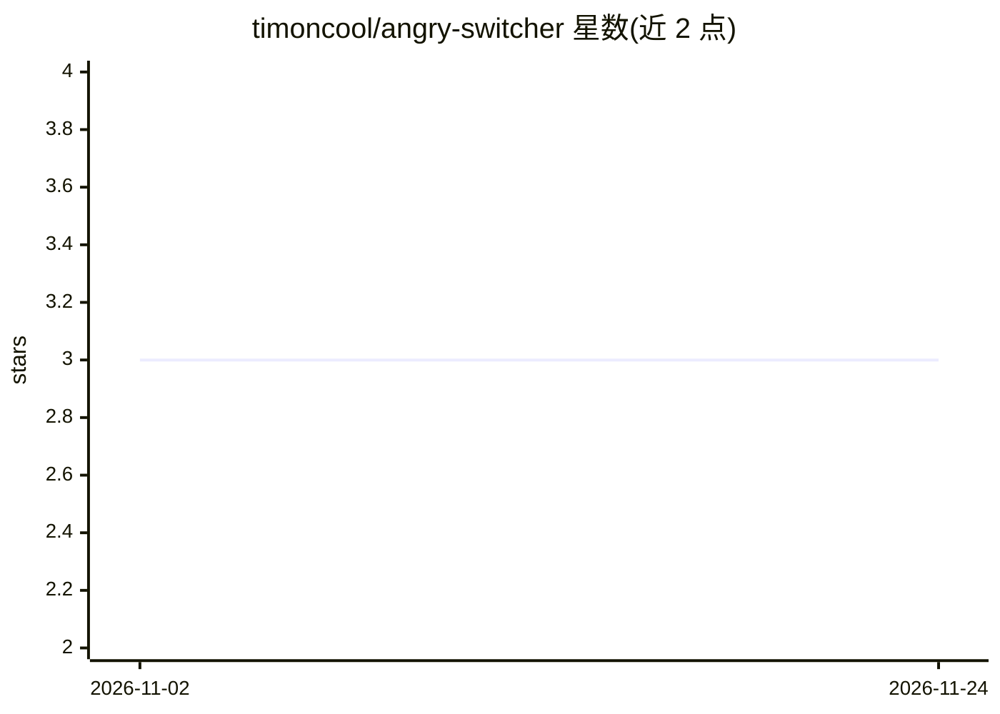

# timoncool/angry-switcher

⭐ — · [GitHub]() · 个人维护 · 中文 README

**Claude Code 插件：在你输入的提示发送前清洗错字、错布局与脏话**

作为 Claude Code 插件运行，在每个提示被 Claude 读取前做改写：修正拼写、音译、键盘布局错误，去除脏话和大写噪音，同时保留路径、标识符、数字与代码，原文以 masked 形式附在改写后。改写由低强度 Sonnet 完成，可切换为用户自有 DeepSeek API key（改写不经过 Anthropic）。带 A/B 对比、成本统计、回放测试与连续三次失败后暂停 10 分钟的机制。仅支持 Claude Code，不支持 claude.ai 聊天。

## 筛选速览

| 维度 | 判定 | 备注 |
|---|---|---|
| AI 角色 | `ai-ecosystem` | LLM/agent 周边工具 |
| 许可风险 | `none` | — |
| 部署形态 | `None` |  |
| 模型依赖 | locked-api |  |
| 硬件要求 | — | 无带数字的原话,不猜 |
| 安装摩擦 | `low` | 无编译、无系统依赖或容器化 |
| 成熟度 | — | 结构信号不足 |

## 能力要点

- 发送前清洗错字、音译、错误键盘布局、脏话与 caps，细节字段强制保留否则按原样发送
- 支持 Sonnet（订阅计划内）或 DeepSeek 自有 API key 两种清洗后端
- A/B 对比、成本统计（token/美元/占比）、JSONL 日志与离线回放测试
- 保存用户自定义改写规则与已批准示例以学习个人风格

## 适用场景

- 用俄语布局误打英文向 Claude Code 提问时自动修正
- 情绪化输入较多时保持提示可读且合规
- 想比较清洗前后的提示效果（A/B 日志与报告）

## 场景标签

`提示工程` `编码 Agent` · 领域:Agent 开发

## 证据(README 行号)

> L14: Angry Switcher is a Claude Code plugin that rewrites every prompt before Claude reads it. Typos, translit, the wron
> L55: Then `/angry model deepseek` switches the layer to DeepSeek and `/angry model sonnet` switches it back. The trade-o
> L67: |`/angry model sonnet` / `deepseek`|clean with Sonnet on your subscription (default) or DeepSeek on your key|

## 星数曲线

2026-11-02 3 → 2026-11-24 3（+0）

---
*卡片 v1 · prompt 1.4 · 生成 2026-11-21 · 置信度 high · 依据 README sha `aa10f33e5294` · [字段定义](../../DATASET.md)*
