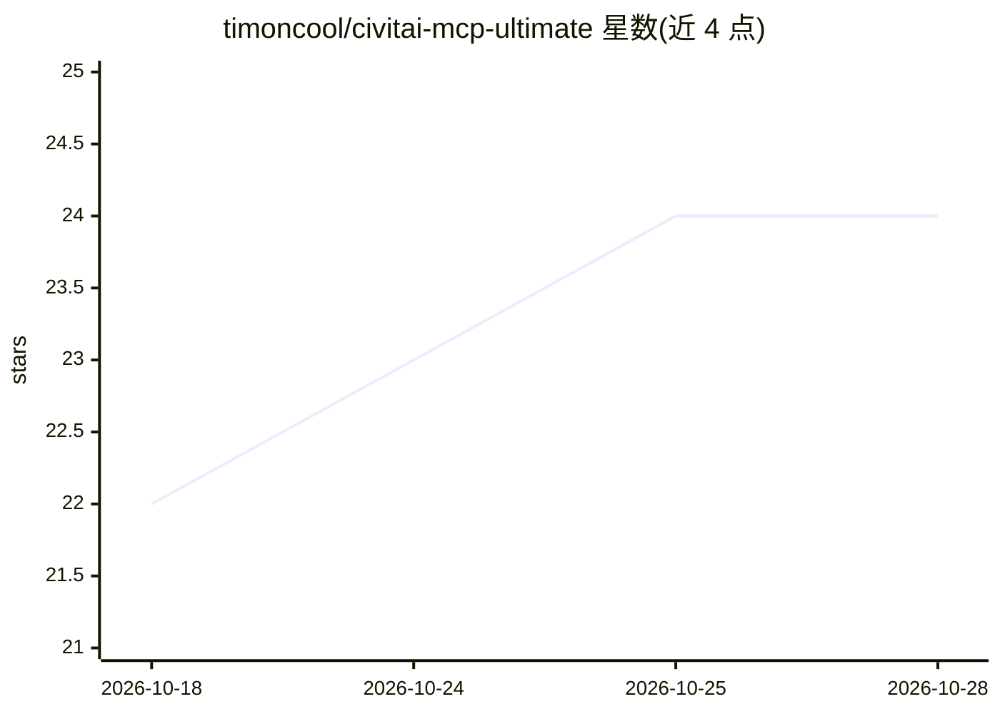

# timoncool/civitai-mcp-ultimate

⭐ 24 · Python · MIT · 推送 2026-10-27 · [GitHub](https://github.com/timoncool/civitai-mcp-ultimate) · [官网](https://pypi.org/project/civitai-mcp-ultimate/) · 个人维护

**Civitai API 的 MCP 服务器：让 AI 助手搜索与下载模型**

基于 Python + FastMCP 的 MCP 服务器，封装 Civitai 公共 REST API v1，提供 14 个工具：模型搜索（Meilisearch 文本搜索 + 40+ 基础模型过滤）、图片浏览与完整生成参数读取、创作者/标签查询、认证下载 URL 与 curl/PowerShell 下载命令生成（含 ComfyUI 路径映射）。供 Claude 等 AI 助手调用，支持 EN/RU 双语输出、预览图缓存与 NSFW 过滤。经 PyPI 安装，API key 可选。

## 筛选速览

| 维度 | 判定 | 备注 |
|---|---|---|
| AI 角色 | `ai-ecosystem` | LLM/agent 周边工具 |
| 许可风险 | `permissive` | MIT |
| 部署形态 | `library` | 以包/库形式分发 |
| 模型依赖 | — | README 未给出锁定关系 |
| 硬件要求 | — | 无带数字的原话,不猜 |
| 安装摩擦 | `low` | 无编译、无系统依赖或容器化 |
| 成熟度 | — | 结构信号不足 |

## 能力要点

- 14 个工具覆盖 Civitai 公共 REST API v1
- Meilisearch 文本搜索与 40+ 基础模型过滤（SD 1.5 → Flux.2）
- 生成 curl/PowerShell 下载命令并映射 ComfyUI 模型路径
- 图片/视频预览自动缓存（~/.civitai-mcp-cache/，24h 清理）

## 适用场景

- 让 AI 助手搜索 Flux/SDXL 等模型的 LoRA 与 Checkpoint
- 浏览热门图片并提取完整生成参数与提示词
- 生成带认证的下载命令直接导入 ComfyUI 模型目录

## 场景标签

 · 领域:AI 模型生态/文生图工具

## 证据(README 行号)

> L3: **The most complete MCP server for Civitai API — search models, browse images with prompts, download LoRAs/Checkpoin
> L10: All from your AI assistant. 14 tools covering 100% of the Civitai public REST API v1.
> L36: claude mcp add civitai -e CIVITAI_API_KEY=your_key_here -- uvx civitai-mcp-ultimate

## 星数曲线

2026-10-18 22 → 2026-10-28 24（+2）

---
*卡片 v1 · prompt 1.4 · 生成 2026-10-27 · 置信度 high · 依据 README sha `0fed5d30b1f6` · [字段定义](../../DATASET.md)*
