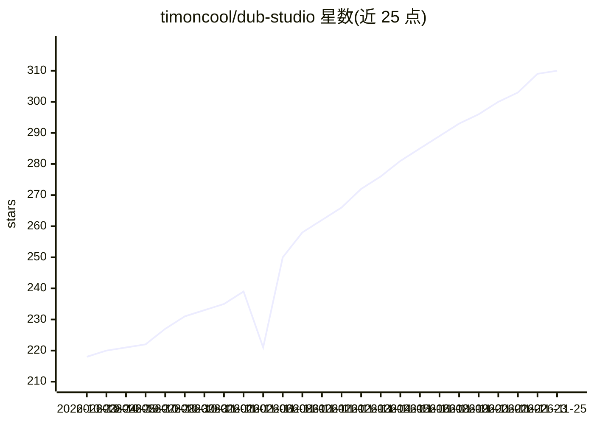

# timoncool/dub-studio

⭐ 310 · Rust · NOASSERTION · 推送 2026-11-23 · [GitHub](https://github.com/timoncool/dub-studio) · [官网](https://timoncool.github.io/dub-studio/) · 个人维护

**Windows 离线 AI 视频配音工作室：本地克隆配音+翻译+字幕**

面向 Windows 的离线视频配音工具：读取视频后自动完成说话人分离、语音识别、翻译（本地 Gemma GGUF）与音色克隆配音，并在画面上替换内嵌文字。五种模式（全配音/旁白/字幕/趣味改写/带说话人转写）可在编辑器中即时切换。全流程默认本地运行（Rust + C++/CUDA 引擎，单个 .exe，无 Python），模型与 ffmpeg 由应用首次启动时下载；翻译、视觉、TTS 等重阶段可经 OpenRouter 可选上云。要求 NVIDIA GPU（8 GB+ 显存），非 NVIDIA 机器属未测试配置。开放 MCP 端口供 Agent 驱动。

## 筛选速览

| 维度 | 判定 | 备注 |
|---|---|---|
| AI 角色 | `ai-native` | 本体是模型或模型工具 |
| 许可风险 | `none` | NOASSERTION |
| 部署形态 | `desktop` | 安装包/桌面程序 |
| 模型依赖 | local-ok | 支持本地模型 |
| 硬件要求 | — | 无带数字的原话,不猜 |
| 安装摩擦 | `high` | 编译与系统依赖俱全 |
| 成熟度 | — | 结构信号不足 |

## 能力要点

- 音色克隆配音：Higgs Audio v3、Qwen3-TTS、Fish Audio Drama 3 等多个本地 TTS 引擎
- 本地翻译与视觉分析用 Gemma（GGUF, llama.cpp）；OCR 内嵌文字替换为本地化标题
- 五种模式与可组合管线（音频×字幕×烧录×改写），支持多语言批量导出
- 开放 MCP 服务器（127.0.0.1:8793）供 Claude Code/Cursor 等 Agent 操控全部功能

## 适用场景

- 把视频整片重新配音成另一种语言并保留原说话人音色
- 为视频生成翻译字幕并替换画面内嵌文字
- 批量把一批视频导出为多种语言版本
- 通过 MCP 让 AI Agent 自主完成配音项目并导出结果

## 场景标签

`语音合成` `语音识别` `OCR` · 领域:内容生成

## 证据(README 行号)

> L21: **Dub Studio** turns any video into a dubbed version in another language — **with the speaker's own voice cloned, c
> L25: It's a **fully native rewrite**. No embeddable Python, no torch, no CUDA wheels. The whole pipeline is **Rust + nat

## 星数曲线

2026-10-23 218 → 2026-11-25 310（+92）

---
*卡片 v1 · prompt 1.4 · 生成 2026-11-25 · 置信度 mid · 依据 README sha `00c8a71354a6` · [字段定义](../../DATASET.md)*
