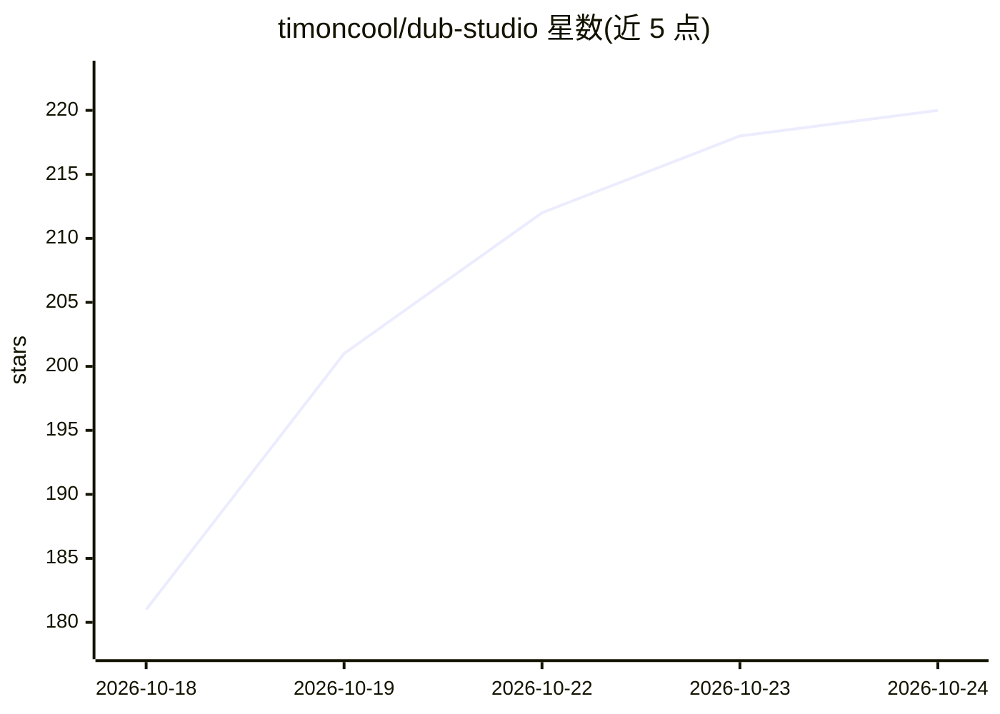

# timoncool/dub-studio

⭐ 220 · Rust · NOASSERTION · 推送 2026-10-23 · [GitHub](https://github.com/timoncool/dub-studio) · [官网](https://timoncool.github.io/dub-studio/) · 个人维护 · 中文 README

**Windows 本地 AI 视频配音工作室：克隆原声译制视频并本地化字幕画面**

面向 Windows 用户的离线 AI 视频配音桌面应用：将视频转成另一语言的配音版本，含声音克隆（Higgs Audio v3）、说话人分离（Nemotron 3）、ASR（Parakeet-TDT/Whisper）、本地翻译（Gemma-4 12B, llama.cpp）、人声分离、屏内文字 OCR 本地化与字幕烧录。Rust + C++/CUDA 单一原生 exe，模型与运行时首启按钮下载；需 NVIDIA GPU 8GB+ VRAM。提供实时编辑器、五种模式与批量处理，重型阶段可选经 OpenRouter 上云，运行时内建 MCP 服务供 AI agent 驱动。

## 筛选速览

| 维度 | 判定 | 备注 |
|---|---|---|
| AI 角色 | `ai-native` | 本体是模型或模型工具 |
| 许可风险 | `none` | NOASSERTION |
| 部署形态 | `desktop` | 安装包/桌面程序 |
| 模型依赖 | local-ok | 支持本地模型 |
| 硬件要求 | `cpu-ok` | |
| 安装摩擦 | `high` | 编译与系统依赖俱全 |
| 成熟度 | `idea` | |

## 能力要点

- 声音克隆 + 说话人分离 + 100+ 语言配音与多语言导出
- 单一原生 .exe（Rust+C++/CUDA），模型与 ffmpeg 首启自动下载
- 屏内文字 OCR 检测、模糊原图并叠印本地化标题
- 运行时内建 MCP 服务，Claude Code/Cursor 等 agent 可全程驱动

## 适用场景

- 把外语视频配音成母语并保留原说话人音色
- 为系列视频做角色 casting，续集自动沿用配音设定
- 生成分角色字幕稿并导出 SRT/TXT
- 用 AI agent 批量处理与修正配音项目

## 场景标签

 · 领域:视频配音/本地化工具

## 证据(README 行号)

> L5: **Free, offline AI video dubbing studio for Windows — re-voice any video into another language with a cloned voice, 
> L21: **Dub Studio** turns any video into a dubbed version in another language — **with the speaker's own voice cloned, c
> L23: By default everything runs **locally on your machine** — no cloud, no subscription; your footage and your voiceprin

## 星数曲线

2026-10-18 181 → 2026-10-24 220（+39）

---
*卡片 v1 · prompt 1.4 · 生成 2026-10-22 · 置信度 mid · 依据 README sha `d52cb0727839` · [字段定义](../../DATASET.md)*
