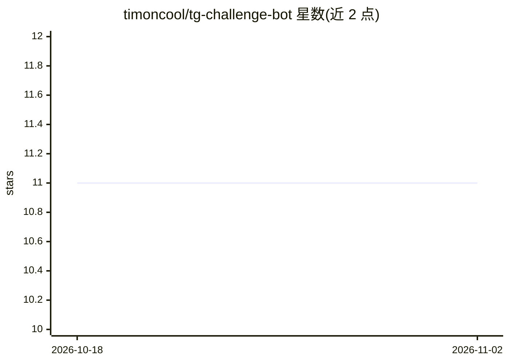

# timoncool/tg-challenge-bot

⭐ 11 · TypeScript · MIT · 推送 2026-11-01 · [GitHub](https://github.com/timoncool/tg-challenge-bot) · [官网](https://t.me/nerual_dreming) · 个人维护

**Telegram 群组 AI 挑战赛机器人：AI 生成主题，Cloudflare Workers 免费部署**

部署在 Cloudflare Workers 上的 Telegram 群组挑战赛机器人：AI（Gemini/OpenRouter/OpenAI）生成每日/每周/每月挑战主题，群成员投票选题、发图参与、靠反应计数评出胜者并进入排行榜。支持一个 bot 服务最多 10 个群组，KV 存储数据；提供主题提案投票、内容模式（vanilla/medium/nsfw）、防转发抄袭、可选的 Cloudflare Pages 网页管理后台（切换 AI 引擎、编辑日程文本、查看花费）。要求群开启 Topics 功能，小群组在免费额度内运行。

## 筛选速览

| 维度 | 判定 | 备注 |
|---|---|---|
| AI 角色 | `ai-native` | 本体是模型或模型工具 |
| 许可风险 | `permissive` | MIT |
| 部署形态 | `None` |  |
| 模型依赖 | locked-api |  |
| 硬件要求 | — | 无带数字的原话,不猜 |
| 安装摩擦 | `low` | 无编译、无系统依赖或容器化 |
| 成熟度 | — | 结构信号不足 |

## 能力要点

- AI 生成挑战主题，记忆最近 50 个避免重复
- 单 bot 多群组（最多 10 个），各组独立挑战与排行榜
- 可选 Cloudflare Pages 管理后台：切换 AI 引擎、日志与花费统计
- 提供 HTTP API（Bearer 鉴权）与 Cron/Telegram 定时消息两种调度方式

## 适用场景

- 给我的 Telegram 群组织每日/每周 AI 出题的图片挑战赛
- 多群组共用一个 bot 管理各自的挑战与排行榜
- 通过网页后台切换 AI 模型并查看 API 花费

## 场景标签

`AI 写作` · 领域:内容生成

## 证据(README 行号)

> L15: - 🗳️ **Голосование за темы**: AI генерирует варианты, участники выбирают
> L216: 1. **Генерация** — AI создаёт темы, бот публикует опрос

## 星数曲线

2026-10-18 11 → 2026-11-02 11（+0）

---
*卡片 v1 · prompt 1.4 · 生成 2026-11-01 · 置信度 high · 依据 README sha `8841502fc2fb` · [字段定义](../../DATASET.md)*
