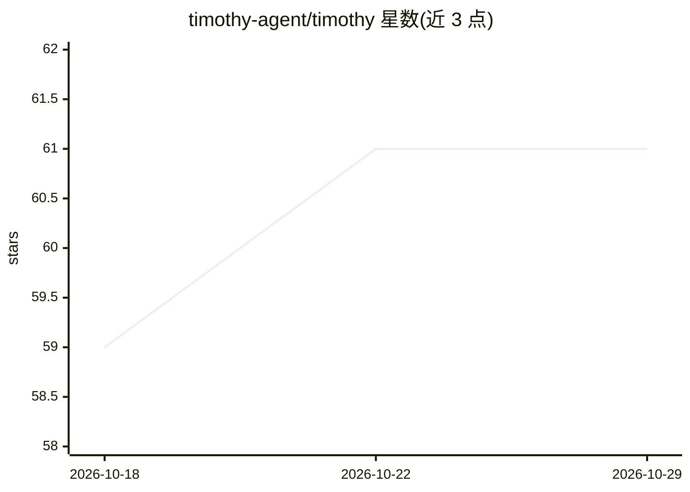

# timothy-agent/timothy

⭐ 61 · Go · AGPL-3.0 · 推送 2026-10-24 · [GitHub](https://github.com/timothy-agent/timothy) · [官网](https://timothy-agent.github.io/docs/) · 组织维护

**自托管的个人 AI agent 控制平面，私域运行多模型智能体**

以 Docker Compose 部署的自托管 AI 智能体平台：Go 微服务加 React Web UI，支持 Anthropic/OpenAI/Bedrock/Ollama 等多模型接入与按任务路由，可将任务委派给 Claude Code、Codex 等 CLI agent。功能包括无人值守任务执行（计划-执行-自验）、沙箱化编码、日程简报、知识库、跨会话记忆，结果可推送到 Telegram/邮件/GitHub。数据与 API key 存于用户自有基础设施。当前为 alpha 阶段，预声明存在粗糙边缘与版本间破坏性变更。

## 筛选速览

| 维度 | 判定 | 备注 |
|---|---|---|
| AI 角色 | `ai-native` | 本体是模型或模型工具 |
| 许可风险 | `viral` | AGPL-3.0 |
| 部署形态 | `desktop` | 安装包/桌面程序 |
| 模型依赖 | local-ok | 支持本地模型 |
| 硬件要求 | — | 无带数字的原话,不猜 |
| 安装摩擦 | `low` | 无编译、无系统依赖或容器化 |
| 成熟度 | `idea` | |

## 能力要点

- 多模型接入与按工作类型路由，支持故障切换与备份模型
- 编码任务在隔离 Docker 沙箱中运行，可委派给 Claude Code/Codex/Cursor 等 CLI agent
- 结果推送至 Telegram/邮件/webhook/GitHub，支持定时简报任务
- 会话为 append-only 事件日志，重启/崩溃后可精确恢复

## 适用场景

- 在自己服务器上运行个人 AI 助手处理邮件、日历与研究任务
- 让 agent 在沙箱中修复代码仓库并提 PR 供审查
- 按预算与模型定价控制各 agent 的调用开销

## 场景标签

`编码 Agent` `AI 助手` · 领域:编码与开发

## 证据(README 行号)

> L14: **The open-source control plane for your personal AI workforce.** Run your own AI agents. Your infrastructure. Your
> L16: Timothy runs on your hardware and works for you around the clock. Shape agents with their own model, tools and know

## 星数曲线

2026-10-18 59 → 2026-10-29 61（+2）

---
*卡片 v1 · prompt 1.4 · 生成 2026-10-24 · 置信度 high · 依据 README sha `99a7eb3e7321` · [字段定义](../../DATASET.md)*
