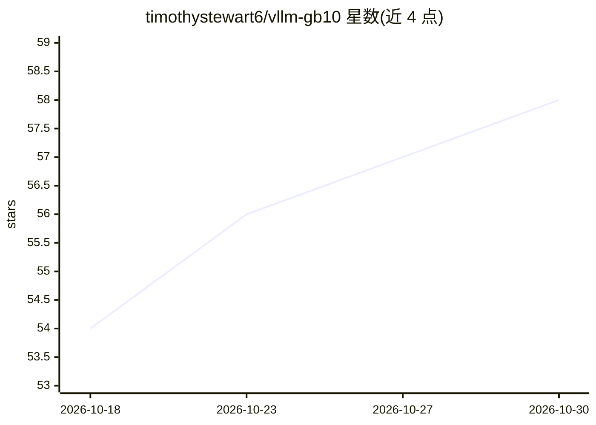

# timothystewart6/vllm-gb10

⭐ 58 · Python · MIT · 推送 2026-10-29 · [GitHub](https://github.com/timothystewart6/vllm-gb10) · 个人维护

**面向 NVIDIA DGX Spark (GB10) 的 vLLM Docker 镜像构建与验证仓库**

为 NVIDIA DGX Spark（GB10 / sm_121a，linux/arm64）打包上游 vLLM 的 Docker 镜像项目：采用 upstream-first 策略，不维护 Spark 分支，构建输入（CUDA 基础镜像、PyTorch、NCCL、FlashInfer、vLLM 等）全部按 commit SHA/digest/精确版本锁定于 versions.env。每个版本发布前在真实 DGX Spark 上跑模型验证（4 个模型覆盖 MoE、Mamba、多模态、NVFP4、FP8 KV cache、投机解码等），验证失败阻断发布，结果随 GitHub Release 公布。镜像不兼容 x86 或其他 GPU 架构。

## 筛选速览

| 维度 | 判定 | 备注 |
|---|---|---|
| AI 角色 | `ai-ecosystem` | LLM/agent 周边工具 |
| 许可风险 | `permissive` | MIT |
| 部署形态 | `desktop` | 安装包/桌面程序 |
| 模型依赖 | local-ok | 支持本地模型 |
| 硬件要求 | — | 无带数字的原话,不猜 |
| 安装摩擦 | `low` | 无编译、无系统依赖或容器化 |
| 成熟度 | — | 结构信号不足 |

## 能力要点

- 所有构建输入按 SHA/digest/精确版本锁定，发布页记录完整组件表
- 每次发布前在真实 DGX Spark 上执行模型验证目录与基准测试，失败阻断发布
- 验证矩阵覆盖 dense/MoE/Mamba/多模态/推理/工具调用/NVFP4/FP8 KV cache/投机解码
- 发布四类镜像标签，其中 latest 仅在模型验证通过后晋升

## 适用场景

- 在 DGX Spark 上运行经验证的 vLLM 推理服务
- 获取带完整组件版本与基准数据的可复现推理镜像
- 参考双 GB10 节点 TP2 部署 DeepSeek 模型的示例方案

## 场景标签

`推理引擎` · 领域:训练与推理

## 证据(README 行号)

> L10: Production-ready, bleeding-edge, upstream-first vLLM
> L14: The project takes an upstream-first approach, tracking vLLM and its dependency
> L29: > The image targets `linux/arm64` with `TORCH_CUDA_ARCH_LIST=12.1a`. It will not

## 星数曲线

2026-10-18 54 → 2026-10-30 58（+4）

---
*卡片 v1 · prompt 1.4 · 生成 2026-10-24 · 置信度 high · 依据 README sha `ac7bd2eea957` · [字段定义](../../DATASET.md)*
