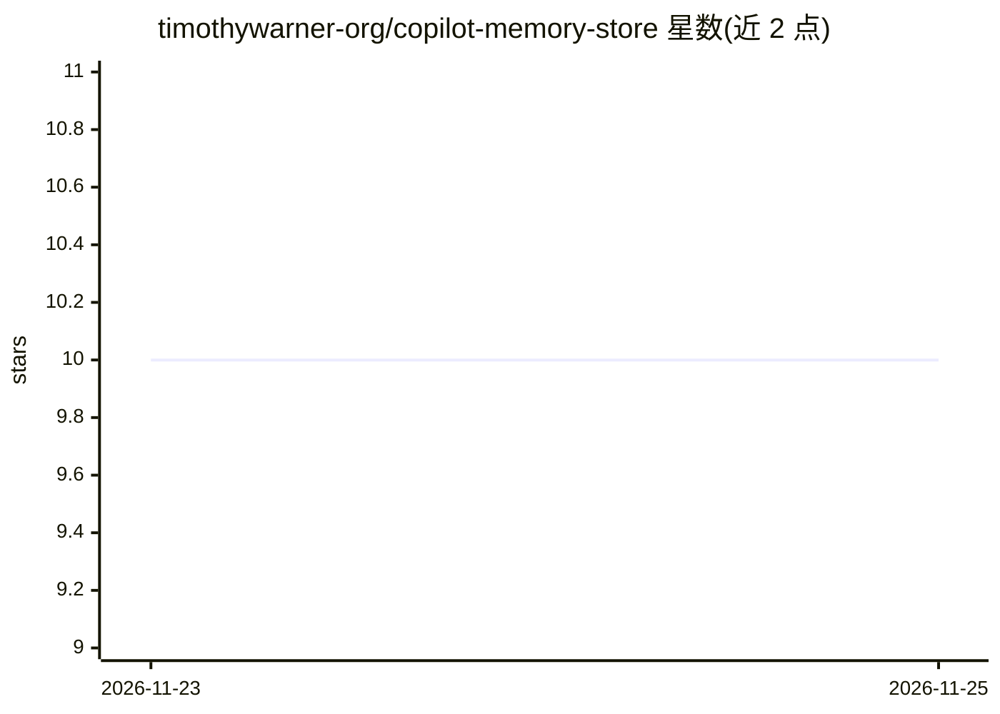

# timothywarner-org/copilot-memory-store

⭐ 10 · TypeScript · MIT · 推送 2025-12-15 · [GitHub](https://github.com/timothywarner-org/copilot-memory-store) · [官网](https://techtrainertim.com) · 个人维护

**为 Copilot 与 MCP 客户端提供本地 JSON 记忆存储的上下文工程工具**

一个本地 JSON 记忆存储工具，面向使用 GitHub Copilot 和 MCP 客户端的开发者，用于上下文工程。核心机制：以带自动关键词的记忆形式存储信息，按关键词+标签+时间衰减做相关性评分检索，并将相关记忆压缩进字符预算（200-8000）注入 LLM 上下文。提供交互式 CLI REPL、暴露 7 个工具/2 个资源/3 个提示词的 stdio MCP 服务器，以及预配置的 VS Code Memory 自定义 agent。可选接入 DeepSeek 做上下文塑形，未配置时回退到确定性压缩。TypeScript 编写，需 npm 构建运行。

## 筛选速览

| 维度 | 判定 | 备注 |
|---|---|---|
| AI 角色 | `ai-ecosystem` | LLM/agent 周边工具 |
| 许可风险 | `permissive` | MIT |
| 部署形态 | `library` | 以包/库形式分发 |
| 模型依赖 | — | README 未给出锁定关系 |
| 硬件要求 | — | 无带数字的原话,不猜 |
| 安装摩擦 | `low` | 无编译、无系统依赖或容器化 |
| 成熟度 | — | 结构信号不足 |

## 能力要点

- CLI REPL、MCP 服务器、VS Code Memory agent 三种使用入口
- 记忆检索按关键词+标签+时间做相关性评分
- 预算约束的上下文压缩，可选 DeepSeek 摘要，未配置时确定性回退
- 7 个 MCP 工具含软删除/恢复与硬删除

## 适用场景

- 把项目决策、代码偏好存为记忆并在 Copilot Chat 中检索
- 为 LLM 任务压缩注入相关上下文
- 教学演示上下文工程概念

## 场景标签

`Agent 记忆` · 领域:Agent 开发

## 证据(README 行号)

> L9: A **local JSON memory store** for context engineering with GitHub Copilot and MCP clients.
> L25: - **MCP Server** - Stdio server exposing tools, resources, and prompts
> L32: LLMs have limited context windows. This tool helps you:

## 星数曲线

2026-11-23 10 → 2026-11-25 10（+0）

---
*卡片 v1 · prompt 1.4 · 生成 2026-11-23 · 置信度 high · 依据 README sha `82c716430e10` · [字段定义](../../DATASET.md)*
