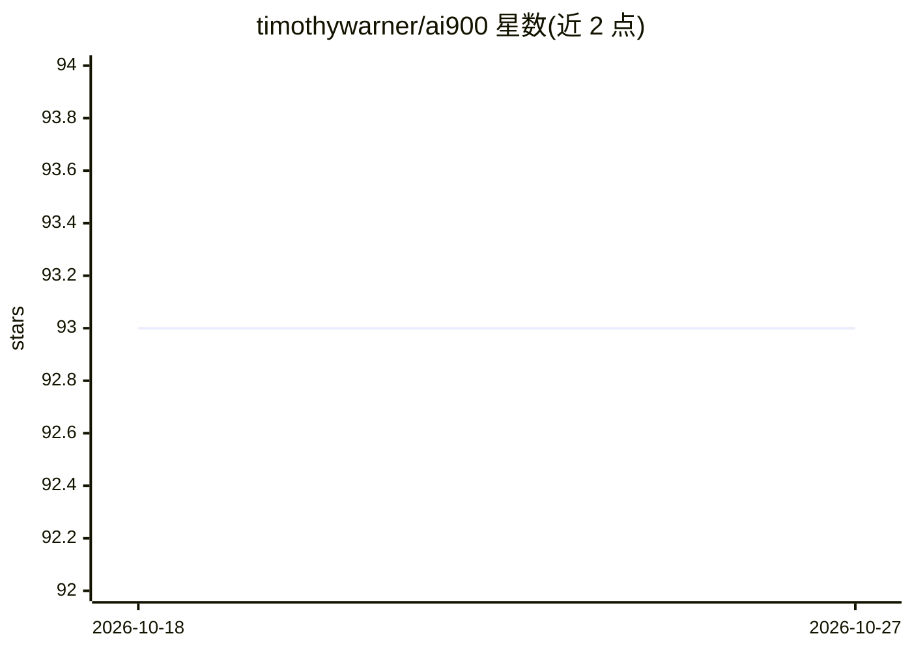

# timothywarner/ai900

⭐ 93 · HTML · MIT · 推送 2026-09-19 · [GitHub](https://github.com/timothywarner/ai900) · [官网](https://techtrainertim.com) · 个人维护

**AI-900 Azure AI 基础认证备考课程仓库（含动手演示）**

微软 MVP Tim Warner 为 Azure AI Fundamentals (AI-900) 认证考试制作的官方备考课程仓库，覆盖 2025 年 5 月更新的考试目标：AI 基础与负责任 AI、机器学习、计算机视觉、NLP、生成式 AI 五个模块。每个演示是独立的 Python 项目（Python 3.13+，uv 管理），需配置 Azure AI Services 密钥运行；另提供 Bicep 一键部署实验环境、Azure 术语新旧对照、学习资源索引与 MCP Microsoft Docs 服务器指南。MIT 许可。

## 筛选速览

| 维度 | 判定 | 备注 |
|---|---|---|
| AI 角色 | `ai-knowledge` | 知识聚合/清单类 |
| 许可风险 | `permissive` | MIT |
| 部署形态 | `None` |  |
| 模型依赖 | — | README 未给出锁定关系 |
| 硬件要求 | — | 无带数字的原话,不猜 |
| 安装摩擦 | `low` | 无编译、无系统依赖或容器化 |
| 成熟度 | — | 结构信号不足 |

## 能力要点

- 五个考试模块的独立 Python 演示项目（uv 管理，交互式菜单）
- Bicep 一条命令部署完整实验环境
- Azure 服务新旧名称对照表（截至 2025 年 5 月）
- MCP Microsoft Docs Server 指南（Claude AI + MS Docs 交互备考）

## 适用场景

- 备考 AI-900 认证并动手练习 Azure AI 服务
- 搭建 Azure AI 实验环境做课程演示
- 查找 AI-900 官方学习路径与模拟题资源

## 场景标签

`教程课程` · 领域:学习与行业

## 证据(README 行号)

> L9: Official preparation course for the **Microsoft Azure AI Fundamentals (AI-900)** certification exam. O'Reilly live t
> L29: For full objective details, see AI-900-exam-objectives.md.

## 星数曲线

2026-10-18 93 → 2026-10-27 93（+0）

---
*卡片 v1 · prompt 1.4 · 生成 2026-10-23 · 置信度 high · 依据 README sha `e1df2398b80b` · [字段定义](../../DATASET.md)*
