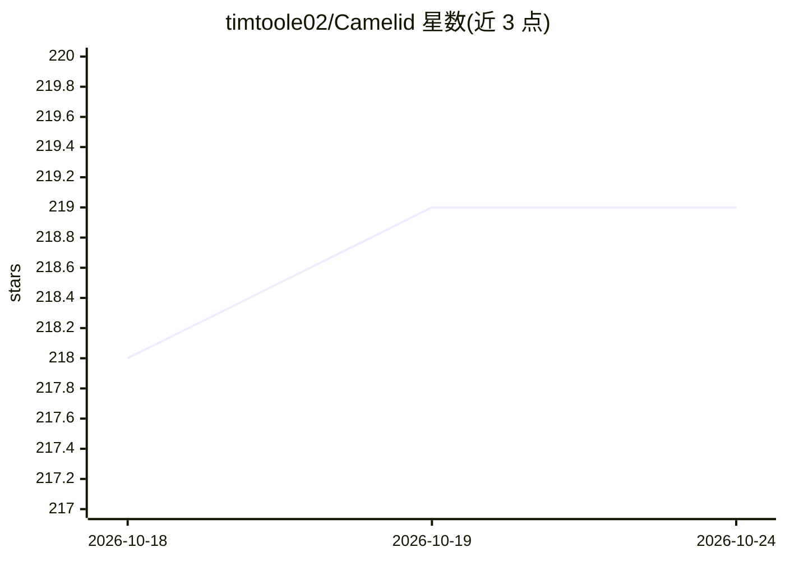

# timtoole02/Camelid

⭐ 219 · Rust · MIT · 推送 2026-10-16 · [GitHub](https://github.com/timtoole02/Camelid) · 个人维护

**Rust 本地推理后端：桌面/浏览器/终端运行 GGUF 模型，OpenAI 兼容 API**

Rust 单二进制的本地推理引擎（内嵌 Web UI），在自有硬件上运行 GGUF 格式的语言、视觉、嵌入与重排模型，无需 Python/Node/Docker。提供桌面应用、浏览器（含手机远程）、终端 UI 与 OpenAI 兼容 HTTP API（chat/completions、embeddings、rerank、function tools 等）。支持 Metal、CUDA 与 CPU 回退；模型兼容性按精确文件与量化对照固定版本 llama.cpp 验证并记录在兼容性清单中，下载可用不代表已验证支持。另含项目上下文、Code in Chat、审批制 Agent 模式与 MCP（预览）等功能。

## 筛选速览

| 维度 | 判定 | 备注 |
|---|---|---|
| AI 角色 | `ai-ecosystem` | LLM/agent 周边工具 |
| 许可风险 | `permissive` | MIT |
| 部署形态 | `None` |  |
| 模型依赖 | local-ok | 支持本地模型 |
| 硬件要求 | — | 无带数字的原话,不猜 |
| 安装摩擦 | `high` | 编译与系统依赖俱全 |
| 成熟度 | — | 结构信号不足 |

## 能力要点

- 引擎与 Web UI 打包为单个 Rust 二进制，运行时无需 Python/Node/Docker
- OpenAI 兼容 API：/v1/chat/completions、/v1/responses、/v1/embeddings、/v1/rerank 与函数工具
- 模型与量化按精确文件对照固定版本 llama.cpp 验证，兼容性证据逐条记录
- Metal/CUDA/CPU 硬件加速，桌面安装包自带 CUDA 运行时

## 适用场景

- 在本机离线运行 GGUF 模型进行日常聊天与文件处理
- 通过 OpenAI 兼容 API 为本地开发提供推理服务
- 手机浏览器远程访问本机推理的对话界面
- 在本地项目中以审批制 Agent 模式执行代码与工具调用

## 场景标签

 · 领域:LLM 基础设施/本地推理

## 证据(README 行号)

> L5: Chat, work with files, and code with supported GGUF models on your own hardware. Use the desktop app, a desktop or m
> L22: - **One Rust engine.** The engine and web UI ship as a single binary, with no Python, Node.js, or Docker required a
> L159: `camelid serve` exposes the browser UI and API on the same port. Read the loaded model ID from `GET /v1/models`, t

## 星数曲线

2026-10-18 218 → 2026-10-24 219（+1）

---
*卡片 v1 · prompt 1.4 · 生成 2026-10-22 · 置信度 high · 依据 README sha `0f5d3f39619a` · [字段定义](../../DATASET.md)*
