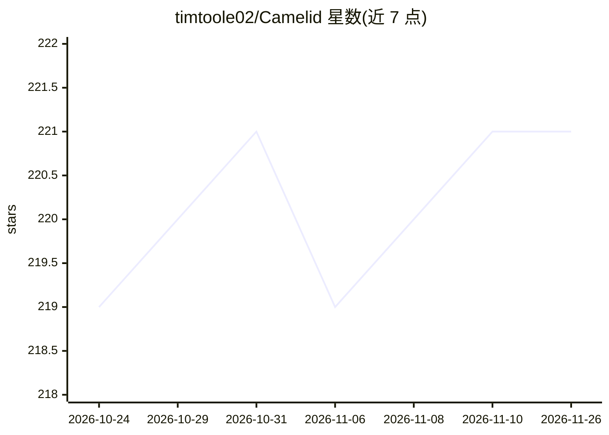

# timtoole02/Camelid

⭐ 221 · Rust · MIT · 推送 2026-11-13 · [GitHub](https://github.com/timtoole02/Camelid) · 个人维护

**Rust 本地 LLM 推理后端+桌面/浏览器聊天应用**

用 Rust 编写的本地推理引擎，以单一二进制提供聊天、文件处理、代码协作与 OpenAI 兼容 API，运行时无需 Python、Node.js 或 Docker。模型兼容性按固定 llama.cpp 参照逐行验证，支持清单明确到具体 GGUF 文件与量化格式。桌面应用捆绑引擎，Windows/macOS 提供安装脚本，Linux 提供 engine archive；Code 功能要求特定 tool_capable 模型并走本地引擎连接，MCP 与 Workspace 为预览特性。

## 筛选速览

| 维度 | 判定 | 备注 |
|---|---|---|
| AI 角色 | `ai-ecosystem` | LLM/agent 周边工具 |
| 许可风险 | `permissive` | MIT |
| 部署形态 | `None` |  |
| 模型依赖 | local-ok | 支持本地模型 |
| 硬件要求 | — | 无带数字的原话,不猜 |
| 安装摩擦 | `high` | 编译与系统依赖俱全 |
| 成熟度 | — | 结构信号不足 |

## 能力要点

- 单二进制引擎+内嵌 Web UI，运行时无 Python/Node/Docker
- OpenAI 兼容 API（chat/completions、responses、embeddings、rerank）
- 兼容性账本按固定 llama.cpp 参照验证，明确各配置限制
- 支持 Metal / CUDA / CPU 三类加速路径

## 适用场景

- 在本机离线运行 GGUF 模型进行日常聊天
- 通过 OpenAI 兼容端点把本地模型接入已有工具链
- 在本地项目中让 AI 完成经审批的代码修改
- 手机浏览器远程访问家中电脑上的推理引擎

## 场景标签

`推理引擎` `聊天机器人` · 领域:对话与助手

## 证据(README 行号)

> L3: **Local AI, powered by Rust.**
> L22: - **One Rust engine.** The engine and web UI ship as a single binary, with no Python, Node.js, or Docker required a

## 星数曲线

2026-10-24 219 → 2026-11-26 221（+2）

---
*卡片 v1 · prompt 1.4 · 生成 2026-11-25 · 置信度 high · 依据 README sha `8a18fcee56c1` · [字段定义](../../DATASET.md)*
