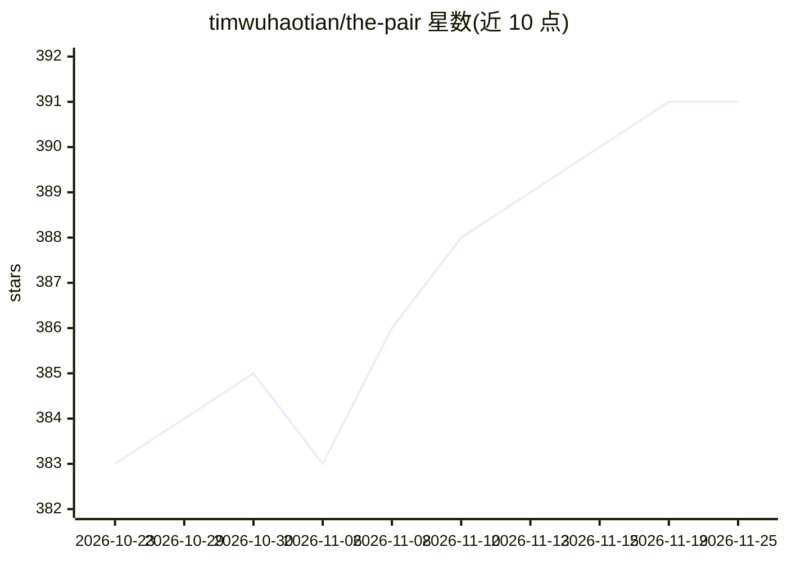

# timwuhaotian/the-pair

⭐ 391 · Rust · Apache-2.0 · 推送 2026-11-23 · [GitHub](https://github.com/timwuhaotian/the-pair) · [官网](https://apps.timwuhaotian.dev/apps/the-pair) · 个人维护 · 中文 README

**双 AI 代理交叉校验的桌面结对编程应用**

Tauri 2 桌面应用：只读的 Mentor 负责规划与审查，Executor 写代码并运行命令，两者在变更进入代码库前相互校验。支持接入任意模型端点（OpenAI Chat、Anthropic 等协议，含本地 Ollama），两个角色可独立选择模型；提供迭代上限、停滞检测、git worktree 隔离、会话快照恢复、用量与成本统计，另附 npm 终端版 Pair Code。需至少一个带凭据的模型端点，Apache 2.0 许可。

## 筛选速览

| 维度 | 判定 | 备注 |
|---|---|---|
| AI 角色 | `ai-native` | 本体是模型或模型工具 |
| 许可风险 | `permissive` | Apache-2.0 |
| 部署形态 | `desktop` | 安装包/桌面程序 |
| 模型依赖 | local-ok | 支持本地模型 |
| 硬件要求 | — | 无带数字的原话,不猜 |
| 安装摩擦 | `low` | 无编译、无系统依赖或容器化 |
| 成熟度 | — | 结构信号不足 |

## 能力要点

- 双代理架构：只读 Mentor 审查 Executor 的每次产出
- 任意模型接入：可导入其他 agent 配置，支持本地 Ollama 离线会话
- Git worktree 隔离运行、基线提交差异追踪与会话快照恢复
- 提供 macOS/Windows/Linux 安装包及 npm 终端版 Pair Code

## 适用场景

- 让两个模型交叉审查 AI 生成的代码后再合入
- 在本地隔离的 worktree 中跑长时编程任务
- 混合搭配不同模型分别担任规划与执行角色
- 通过 Ollama 本地模型做全离线的编程会话

## 场景标签

`多智能体` `编码 Agent` `代码审查` · 领域:Agent 开发

## 证据(README 行号)

> L7: Open-source AI pair programming for your desktop: a read-only **Mentor** plans and reviews,
> L29: A model that writes code and then reviews its own code tends to agree with itself. The Pair splits the job in two a
> L105: - **Bring your own endpoint** — import another agent's configuration (opencode, codex, claude, kimi, pi, omp, gemi

## 星数曲线

2026-10-23 383 → 2026-11-25 391（+8）

---
*卡片 v1 · prompt 1.4 · 生成 2026-11-25 · 置信度 high · 依据 README sha `1caf86826789` · [字段定义](../../DATASET.md)*
