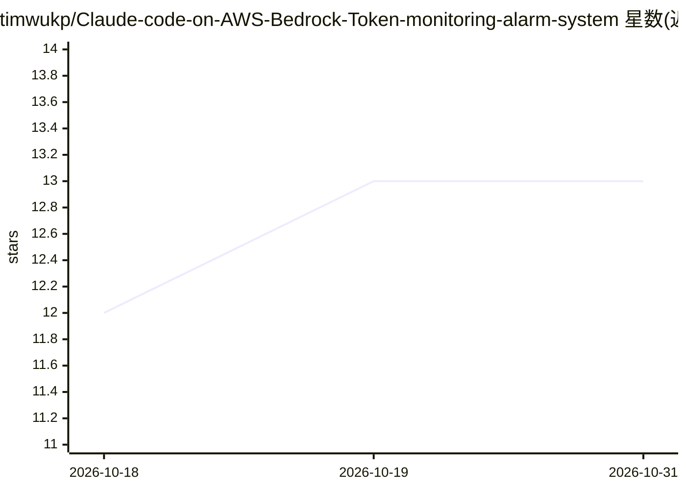

# timwukp/Claude-code-on-AWS-Bedrock-Token-monitoring-alarm-system

⭐ 13 · TypeScript · MIT · 推送 2026-10-30 · [GitHub](https://github.com/timwukp/Claude-code-on-AWS-Bedrock-Token-monitoring-alarm-system) · [官网](https://github.com/timwukp/Claude-code-on-AWS-Bedrock-Token-monitoring-alarm-system) · 组织维护

**多租户 AWS Bedrock token 用量监控与成本治理平台**

面向运营 Bedrock 工作负载（编程助手、RAG、agent）的组织的可观测性与成本治理平台：读取 Bedrock Model Invocation Logging，经 S3/Glue/Athena 与 Lambda 聚合，按项目/用户归因 token 成本（四级优先级阶梯，以带标签的应用推理配置文件为首）；接入 CloudWatch 指标、AWS Cost Anomaly Detection（ML 异常检测）、Budgets 硬停与按主体遏制，并提供 React 仪表盘（用量、成本、异常、DORA 指标、AI 编程 ROI、模型延迟）。以 AWS CDK（TypeScript）提供 10 个独立可部署 stack，强制实施默认关闭，多租户 JWT 隔离。限制：仅针对 AWS 原生环境，不改变 Bedrock 定价或行为，估算值与账单每月对账。

## 筛选速览

| 维度 | 判定 | 备注 |
|---|---|---|
| AI 角色 | `ai-ecosystem` | LLM/agent 周边工具 |
| 许可风险 | `permissive` | MIT |
| 部署形态 | `library` | 以包/库形式分发 |
| 模型依赖 | locked-api |  |
| 硬件要求 | — | 无带数字的原话,不猜 |
| 安装摩擦 | `medium` | 含编译或系统依赖之一 |
| 成熟度 | — | 结构信号不足 |

## 能力要点

- 四级优先级的项目成本归因阶梯（tagged AIP / requestMetadata / 身份提示 / untagged）
- AWS Cost Anomaly Detection 的 ML 学习基线异常检测 + SNS 告警
- 按各自费率计价 prompt-cache 读写（0.1×/1.25×），估算与账单每月对账
- 每 GitHub 仓库的 DORA 指标（All/AI-assisted/Human-only PR 分组）与 AI 编程 ROI 页面
- 10 个独立可部署 CDK stack，Cognito 登录与每请求租户隔离

## 适用场景

- 搞清本月 Bedrock 账单是哪个团队/项目产生的
- 在成本异常（如 agent 死循环）发生时收到告警并自动遏制
- 评估 AI 编程助手的投入产出（每项目花费 vs 交付指标）
- 监控 Bedrock 调用延迟与 token 配额余量

## 场景标签

`LLM 可观测性` · 领域:评测与运维

## 证据(README 行号)

> L4:  A cross-industry, multi-tenant platform for monitoring token usage, detecting cost anomalies,
> L70: |**Observability** — proactively track & alert on token cost|Layered: CloudWatch metrics, AWS Cost Anomaly Detectio
> L74: **Scope of what the platform adds.** It does not change Bedrock's pricing or behavior. Its

## 星数曲线

2026-10-18 12 → 2026-10-31 13（+1）

---
*卡片 v1 · prompt 1.4 · 生成 2026-10-31 · 置信度 mid · 依据 README sha `3da5fc285ff2` · [字段定义](../../DATASET.md)*
