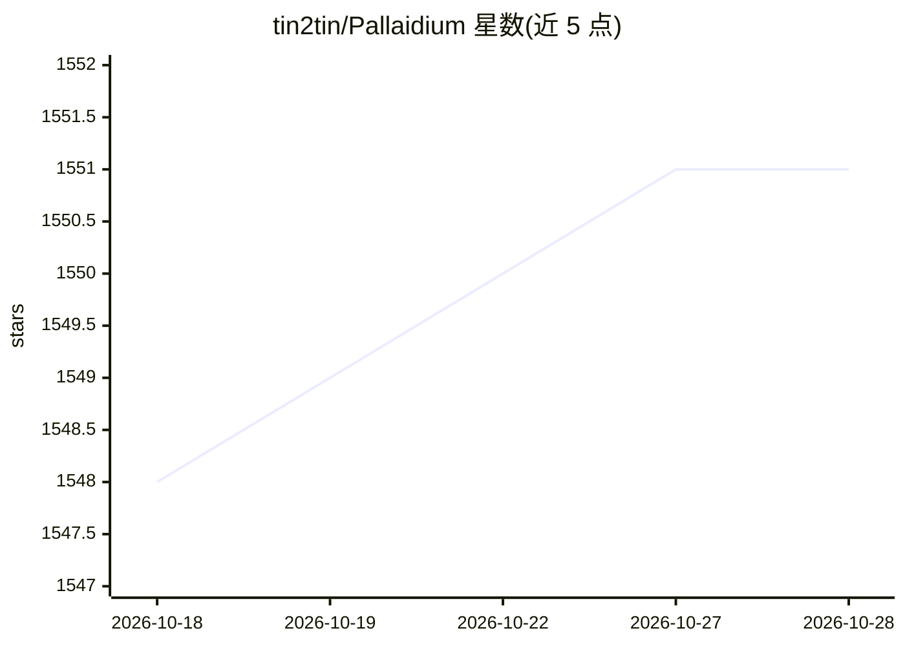

# tin2tin/Pallaidium

⭐ 1,552 · Python · GPL-3.0 · 推送 2026-10-17 · [GitHub](https://github.com/tin2tin/Pallaidium) · [官网](https://tin2tin.github.io/Pallaidium/) · 个人维护

**集成在 Blender 视频编辑器中的免费生成式 AI 电影工作室**

作为 Blender 5.2+ 的 VSE 插件运行，覆盖从文本/图像/视频到图像、视频、文本、音频、音乐、语音的生成工作流：剧本分解为时间条、生成图像并动画化、配音配乐，也支持反向从成片提取字幕重建剧本。默认本地运行模型（需 CUDA Nvidia 显卡 6-16GB VRAM），可选通过 OpenAI-/v1/ 方言后端契约对接 ComfyUI、fal.ai、LocalAI 等远程后端。支持 ControlNet、LoRA、批量处理与异步渲染队列。主要面向 Windows，Linux 支持有限。

## 筛选速览

| 维度 | 判定 | 备注 |
|---|---|---|
| AI 角色 | `ai-native` | 本体是模型或模型工具 |
| 许可风险 | `dual` | GPL-3.0 |
| 部署形态 | `desktop` | 安装包/桌面程序 |
| 模型依赖 | — | README 未给出锁定关系 |
| 硬件要求 | `gpu-8g` | |
| 安装摩擦 | `medium` | 含编译或系统依赖之一 |
| 成熟度 | — | 结构信号不足 |

## 能力要点

- 文本/图像/视频到六种媒体类型的生成矩阵
- 默认本地运行模型，可选远程后端（ComfyUI/fal.ai/自定义 OpenAI 兼容服务器）
- 支持 ControlNet、LoRA、IP Adapter、批量生成与异步渲染队列
- 生成结果自动加入 VSE 时间线

## 适用场景

- 在 Blender 内从歌词或场景描述原型化完整 AI 电影制作流程
- 对时间线条做批量 AI 生成与精修
- 将生成任务卸载到更强机器或云端的后端服务器

## 场景标签

`图像生成` `视频生成` `语音合成` · 领域:内容生成

## 证据(README 行号)

> L3:  A free generative AI movie studio integrated into the Blender Video Editor.
> L14: Pallaidium turns that insight into a workflow. Prototype the full production cycle with AI before committing to a s
> L35: |Text to video|Text to image|Text to text|

## 星数曲线

2026-10-18 1,548 → 2026-10-28 1,551（+3）

---
*卡片 v1 · prompt 1.4 · 生成 2026-10-21 · 置信度 high · 依据 README sha `08eafc0c88c5` · [字段定义](../../DATASET.md)*
